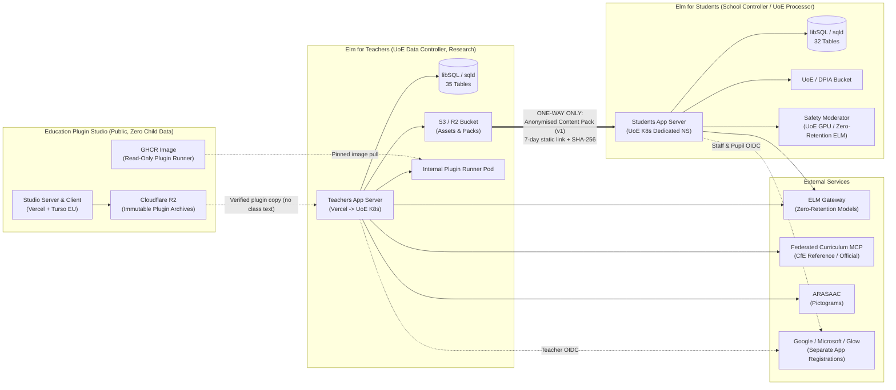
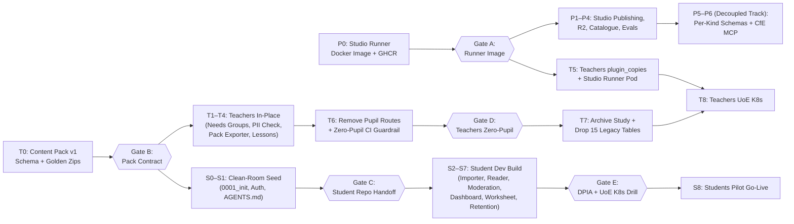

# ELM Three-System Split: Architecture, Contracts & Extraction Plan

**Date:** 25 November 2026  
**Author:** Sam Green (University of Edinburgh)  
**Status:** Draft Specification (code-verified against `epistemic-differentiation-workshop` and `education-plugin-studio`)

This document specifies the target architecture, isolation guarantees, cross-system contracts, knowledge protocol separation, and phased extraction plan for splitting ELM into three independent systems. Companion product and developer specifications cover each system in detail:

- [Elm for Teachers — Product & Developer Specification](./02-elm-for-teachers-spec.md)
- [Elm for Students — Product & Developer Specification](./03-elm-for-students-spec.md)
- [Education Plugin Studio — Product & Developer Specification](./04-education-plugin-studio-spec.md)

---

## 1. Executive Summary & Core Architectural Decision

The combined ELM codebase is split into **three completely independent systems**:

| System | Repository | Purpose | Data Held |
| :--- | :--- | :--- | :--- |
| **Education Plugin Studio** | `ssfgreen/education-plugin-studio` | Public platform for authoring, testing (via hosts), and publishing educational pedagogy and skill plugins over HTTP and MCP. | Author accounts, plugin drafts, published versions, eval runs. **Zero child data.** |
| **Elm for Teachers** | `ssfgreen/epistemic-differentiation-workshop` (evolved in place) | Research-instrumented AI worksheet and lesson-material assistant for consenting teachers. | Teacher workspaces, documents, chats, needs groups, research events. **Zero new pupil PII.** |
| **Elm for Students** | `ssfgreen/elm-for-students` (greenfield repo) | Safeguarding-first AI learning tools (reader, worksheet supporter, timetable helper) for pupils under school and teacher oversight. | School organisations, staff, pupil identities, assignments, pupil transcripts, moderation verdicts, flags. **Zero research data.** |

### Architectural Decision: Isolated Repositories, Zero Shared Packages (Option D)

Elm for Teachers (maintained by Sam Green with AI coding agents) and Elm for Students (owned by a separate developer) will evolve independently after the split. The project therefore adopts **three separate repositories, three separate deployments, and zero shared npm packages**.

- **Why no monorepo or shared packages:** Cross-repo internal packages create lockfile churn, review bottlenecks, and risk unannounced upstream changes entering pupil safeguarding code. With AI coding agents, copying proven modules at the split boundary (with a source-path and commit header comment) lets each repository own its security posture and release cadence. This pattern is already proven in `education-plugin-studio` (`docs/copied-from-elm.md`).
- **What IS shared across systems:**
  1. **Container image boundary:** Plugin Studio publishes a read-only **Plugin Runner** container image (`ghcr.io/.../plugin-runner`). Elm for Teachers (and later Elm for Students, when pupil tools consume plugins) runs its own isolated copy inside its own cluster.
  2. **Versioned data contract:** A schema-validated **Content Pack (v1)** format with deterministic SHA-256 hashing and golden test fixtures committed in both Elm repositories.
  3. **Open protocol boundaries:** Model Context Protocol (MCP) for plugins and federated Curriculum MCP servers.

---

## 2. The Five-Level Separation Guarantee

To satisfy UK GDPR, University of Edinburgh Information Security, and school/local-authority DPIAs, pupil data in Elm for Students is strictly isolated from Elm for Teachers and its research record across five levels:

1. **Data:** Separate libSQL databases, separate object storage buckets, and separate backup schedules. No primary key or foreign key crosses a database boundary.
2. **Runtime:** No running process handles both teacher research sessions and pupil text. Each system runs its own app server, moderation pipeline, and (where used) internal plugin runner pod.
3. **Flows:** Information moves **strictly one way** — from Elm for Teachers to Elm for Students via an anonymised static Content Pack. **Nothing ever flows back** from Elm for Students to Elm for Teachers (no callbacks, no POST acknowledgements, no shared telemetry).
4. **Accountability:** Separate domains, separate OIDC app registrations (Elm for Teachers never requests pupil permissions), separate privacy notices, and separate legal roles:
   - *Elm for Teachers:* University of Edinburgh as **Data Controller** (research study with consenting teachers).
   - *Elm for Students:* School / Local Authority as **Data Controller**; University of Edinburgh as **Data Processor**.
5. **Observability & IAM:** Separate log indices, error tracking projects, Kubernetes namespaces (or clusters), secrets, and developer credentials. An agent or developer working on Elm for Teachers never holds credentials or log access to Elm for Students.



---

## 3. Hosting & Deployment Topology

| System | Hosting | Database & Storage | Operational Notes |
| :--- | :--- | :--- | :--- |
| **Education Plugin Studio** | Vercel + Cloudflare R2 | Turso (libSQL, EU) | Public users; zero child data. Hosts public/limited/draft runner for commercial AI hosts (Claude, ChatGPT). Publishes read-only runner container image. |
| **Elm for Teachers** | Vercel now; migrating to UoE Kubernetes (via Oracle London staging if needed) | Turso (EU) -> UoE `sqld` + Litestream continuous backup to UoE storage; S3/R2 bucket | Zero new pupil data. Acceptable on EU commercial hosting during active teacher pilot provided sub-processors are listed in ethics/privacy notices. Runs its own internal runner pod on K8s. |
| **Elm for Students** | **UoE Kubernetes only (post-DPIA)** | UoE `sqld` + Litestream to UoE storage; dedicated bucket | Dedicated namespace (or cluster) with `NetworkPolicy` isolation. Dedicated education-categorised domain for school web filters (Smoothwall, Lightspeed). Non-streamed chat by default for buffered filter traffic and pre-display output moderation. Runs moderator on UoE GPUs or zero-retention ELM gateway. |

All three databases run **libSQL (SQLite-compatible)**, with all new migrations written in **PostgreSQL-compatible SQL** (`TEXT` ISO 8601 timestamps, `TEXT` ULID/UUID IDs, `TEXT` JSON columns, `INTEGER CHECK (x IN (0, 1))` booleans, quoted reserved keywords such as `"end"`).

---

## 4. Knowledge Architecture: Separating Curriculum, Pedagogy, and Skills

While deployment topology stays at **three systems** (not six), the educational knowledge those systems consume is separated into **three distinct protocols and schemas**. Keeping them conceptually separate prevents flattening national curriculum graphs into generic plugin folders and lets pedagogy plugins reference statutory standards without duplicating government text.

| Layer | What It Represents | Ownership | Data Shape | MCP / Agent Interface |
| :--- | :--- | :--- | :--- | :--- |
| **Curriculum** | What must be learned (statutory outcomes, benchmarks, prerequisites, misconceptions) | Governments, exam boards, or open-source maintainers (e.g., Education Scotland, Oak, Learning Commons) | Layered Knowledge Graph (CASE / JSON-LD compatible UUIDs + directed edges) | `resolve_standard`, `get_prerequisites`, `get_benchmarks`, `get_misconceptions` |
| **Pedagogy** | How to teach and adapt it (scaffolding, dyslexia adaptations, cautions, evidence-backed claims) | Educators, researchers, subject associations, schools | Structured Library (entries, claims, sources, facets, teacher overrides) | `entries`, `entry`, `claims`, `facets` (evolving to `find_adaptations`, `get_approaches`) |
| **Skills** | How the AI behaves (workflows, rubrics, Socratic questioning, formatting rules) | Tool builders, researchers, power-user teachers | Procedural Instructions (Agent Skills `SKILL.md`, recipes, eval cases) | Loaded into host agent context / MCP prompts & resources |

### Minimal Open-Source Curriculum Graph (Four Layers)

To accommodate contrasting national models (Scotland's broad CfE levels, England's Key Stages, US single-grade standards, France's multi-year cycles) without forcing a spreadsheet shape:

1. **Statutory Nodes:** Official statements with stable URI/UUID (1EdTech CASE / JSON-LD compatible), official code (`MNU 2-07a`), jurisdiction, subject, level/age band, and statement text.
2. **Dependency Edges (Progressions):** Directed `requires` / `leads_to` links separating fixed subject prerequisites (e.g., fractions before dividing fractions) from optional sequencing.
3. **Assessment & Misconception Layer:** Benchmarks (mastery indicators) and common student misconceptions linked by node URI.
4. **Pedagogical / Sequencing Layer (External):** Kept *outside* the statutory graph so schools and pedagogy plugins overlay local sequencing and adaptations by node URI without mutating statutory data.

### Sequencing Rule: Decouple from the Three-System Split

Today, [`runner/src/curriculum/schemas.ts`](`education-plugin-studio/packages/runner/src/curriculum/schemas.ts`) is hardcoded to CfE's five levels, [`pedagogy-scotland`](../../packages/server/src/gateway/pedagogy-message.ts) embeds 30 curriculum reference entries in `pedagogy.yaml`, and [`manifest.ts`](`education-plugin-studio/packages/runner/src/plugin/manifest.ts`) uses `format: 1` (collection-based, no top-level `kind`).

To avoid stalling the three-system split:
- **During the split (Phase 3):** Add nullable `classes.curriculum_profile` (JSON) and `class_curriculum.standard_uri` (TEXT) in Elm for Teachers, and include optional `standard_uris` in Content Pack v1. Keep existing CfE curriculum lookup working unchanged.
- **Follow-on track (post-split):** Stand up the open-source CfE Reference Curriculum MCP server, evolve Plugin Studio to per-kind strict schemas (`format: 2` or explicit `kind`), and detach the 30 embedded curriculum reference entries from `pedagogy-scotland`.

---

## 5. Cross-System Contract: Content Pack (v1)

A **Content Pack** is a self-contained, immutable, anonymised `.zip` archive exported from Elm for Teachers and imported into Elm for Students.

### 5.1 Archive Layout

```text
pack.zip
├── manifest.json       Metadata, optional curriculum URIs, SHA-256 per file
├── blocks.json         Frozen live document blocks in display order
├── prompts.json        Optional suggested pupil prompt buttons
└── assets/             Referenced raster images (validated MIME + size cap)
    └── <asset_id>.<ext>
```

### 5.2 Schema Rules (`content-pack-v1.schema.ts`)

- **`manifest.json`:**
  - `format_version`: literal `"1.0"`
  - `pack_id`: ULID string
  - `kind`: `"reading" | "worksheet"`
  - `title`: non-empty string (max 200 chars)
  - `subject`: optional string
  - `stage`: optional string
  - `standard_uris`: optional `string[]` (referenced curriculum node URIs or official codes such as `MNU 2-07a` so Elm for Students can display alignment without querying Elm for Teachers)
  - `created_at`: ISO 8601 UTC timestamp
  - `files`: ordered array of `{ path: string, sha256: string, bytes: number, mime?: string }` covering `blocks.json`, optional `prompts.json`, and every file in `assets/` (sorted lexicographically by `path`, excluding `manifest.json` itself)
  - `content_hash`: `sha256:<64 hex>` computed deterministically over the canonical file list and each file's bytes in manifest order.
- **`blocks.json`:**
  - Ordered array of `{ id: string, type: string, content: string }` matching [`ReadingBlock`](../../packages/server/src/readings/copy.ts) from `liveBlocks()` — live blocks only.
  - **Suggestions stripped:** No `pending` proposals, no rejected/deleted blocks, no `origin`, no `origin_turn`, no `derived_from`.
  - **Pictures & inline SVGs:** Raster images are referenced as `asset:<asset_id>` and bundled under `assets/<asset_id>.<ext>` (allowed MIME types: `image/png`, `image/jpeg`, `image/webp`, `image/gif`; per-asset cap 5 MB, total pack cap 25 MB). Inline drawn SVGs (which [`ReadingBlocks.tsx`](../../packages/client/src/reader/ReadingBlocks.tsx) already renders via `cleanSvg`) are either sanitised on export and again on import via `cleanSvg`, or extracted into `assets/` with strict SVG sanitisation — never rendered as raw HTML.
  - **Worksheet writing lines:** `<line/>` tokens ([`readerText.ts`](../../packages/shared/src/readerText.ts)) are preserved in `blocks.json` so Elm for Students' Worksheet Supporter can render interactive response slots or printable lines.
- **`prompts.json` (optional):**
  - Array of `{ label: string, instruction: string, after_highlight: boolean, follow_up: boolean }` (max 20 prompts). Imported as `source = 'pack'` only if the teacher confirms them during import.

### 5.3 Strictly Excluded Data (Contract-Tested)

A Content Pack must **never** contain:
- Teacher names, emails, display names, or account IDs
- Workspace `session_id`, `participant_token`, or `doc_id` / `thread_id`
- Chat transcripts, model calls, or system prompts
- Document comments or revision history
- Class names, school names, class notes/context, or needs groups
- Proposed or rejected assistant edits

### 5.4 Strictly One-Way Transfer Flow

1. In **Elm for Teachers**, the teacher clicks **Send to Elm for Students** on a document (choosing `reading` or `worksheet`, and optionally picking prompts).
2. Elm for Teachers builds the zip bundle from live blocks and referenced assets, computes `content_hash`, uploads the zip to its object bucket under a random key, records a `content_packs` row (`expires_at = now + 7 days`, `revoked_at = null`), and presents a copyable/clickable import link:
   `https://<students-domain>/import?url=<encoded-pack-download-url>&hash=<content_hash>`
3. **Download endpoint & revocation:** The `<pack-download-url>` points to a stateless Elm-for-Teachers download route (`/api/packs/<code>`) keyed by `link_code_hash`. On `GET`, it checks `expires_at` and `revoked_at`, and responds with a **302 redirect** to a short-lived (60 s) presigned R2 GET URL.
   - *Why redirect:* Avoids Vercel's 4.5 MB serverless response limit for image-heavy worksheets.
   - *Link-scanner resilience:* `GET /api/packs/<code>` **never burns the code**. School security filters (Microsoft Defender Safe Links, Smoothwall) can pre-fetch the URL safely, and the teacher can import the same pack into two classes within the 7-day window.
   - *Revocation:* Revoking sets `revoked_at` **and** deletes the zip from the bucket.
   - *Strictly one-way:* Elm for Students **never sends a POST acknowledgement** back to Elm for Teachers. Expiry (7 days) and cleanup jobs delete expired packs automatically.
4. In **Elm for Students** (signed in separately as school staff), the teacher opens `/import`, reviews the preview (title, kind, block count, prompts), chooses a class/assignment, and confirms import.
5. Elm for Students' server fetches the zip (enforcing an HTTPS allow-list for the Teachers origin + bucket host, size cap, and timeout), verifies `content_hash` against `hash` and every file's SHA-256 against `manifest.json`, validates all JSON against its local copy of `content-pack-v1.schema.ts`, extracts assets into its own bucket (`pack_assets`), and writes `content_packs` (`UNIQUE(organisation_id, pack_id)`).

---

## 6. Cross-System Contract: Plugin Runner Image

- **Owner:** `ssfgreen/education-plugin-studio` (`packages/runner`).
- **Prerequisite (Phase 0):** Move the `runner` Docker build target currently in [`epistemic-differentiation-workshop/Dockerfile`](../../Dockerfile) into `education-plugin-studio/Dockerfile` and add a GitHub Actions workflow publishing versioned, digest-pinned `linux/amd64` + `linux/arm64` images to GHCR.
- **Runtime contract:** Read-only HTTP/MCP server (`PORT=8787`, `/health`, `/p/<owner>/<name>[@<ver>]/...`). Holds zero database credentials and logs zero search terms.
- **Verification:** `contract/` in Plugin Studio holds golden plugin trees, `manifest.cases.json`, and `expected.json`. Both Elm for Teachers and Plugin Studio pin the same schema expectations without importing each other's code.

---

## 7. Sequenced Development Plan (Cross-Repo Master Schedule)

Development proceeds across **three independent repository lanes** plus one **decoupled follow-on track** (Federated Curriculum MCP and per-kind `format: 2` manifests), synchronised only at six explicit handoff gates (**A–F**). Neither the Curriculum MCP redesign nor `elm-for-students` runner integration blocks the core split.



### Master Sequence & Handoff Gates

| Step | Repo / Owner | Milestone | Depends On | Exit Gate / Verification |
| :--- | :--- | :--- | :--- | :--- |
| **1** | Plugin Studio (Sam) | **P0 — Runner Container Image:** Multi-arch `Dockerfile` (`runner` target) + GHCR publish workflow + mounted plugin directory loader. | — | **Gate A:** Digest-pinned image pulls cleanly, passes `contract.test.ts` inside container, answers `/health` and `/p/*`. |
| **2** | Elm for Teachers (Sam) | **T0 — Content Pack (v1) Contract:** Author `content-pack-v1.schema.ts` (Zod), generate `reading-with-image.zip` (raster + inline SVG) and `worksheet-with-prompts.zip` (`<line/>` + prompts), add PII-exclusion contract test. | — | **Gate B:** Golden fixtures verified by deterministic SHA-256; contract test proves zero teacher/session/comment/suggestion leakage. |
| **3** | Elm for Students (Sam) | **S0–S1 — Clean-Room Seed:** Brand-new repo (no Git history, no legacy migrations), `0001_init.sql` (32 tables), copied `tests/contracts/`, `AGENTS.md` boundaries, cherry-picked OIDC (`openid profile` + Glow allow-list), `pupil-logins`, non-streamed ELM client, pure-React `ReadingBlocks`, K8s manifests. | Gate B | **Gate C (Handoff):** `pnpm check` green, `0001_init.sql` applies cleanly on libSQL and PostgreSQL syntax check, golden Content Pack fixtures validate, repo handed to Student developer. |
| **4** | Elm for Teachers (Sam) | **T1–T4 — Teachers Evolution:** Migrations for 7 new tables + class/thread columns; feature-gated `needs_groups`; zero-retention PII moderation on `classes.note` & `needs_groups`; one-way Content Pack exporter + `/api/packs/<code>` 302 redirect; `lesson_progress`. | Gate B | Exported pack imports cleanly against Gate B schema; PII moderation fails closed when `zero_retention` is false; `scripts/ci.sh` green. |
| **5** | Elm for Teachers (Sam) | **T6 — Pupil Route Removal & Guardrail:** Delete pupil/reader routes & UI (`pupils/`, `reader/`, `screens/pupil/`, `WhoScreen` pupil branch); add CI test asserting zero `/api/pupil/*` or `/r/*` routes and zero writes to legacy pupil tables. | T1–T4, Gate C | **Gate D:** Zero-pupil CI guardrail green; teacher-only auth & editor e2e green. |
| **6** | Plugin Studio (Sam) | **P1–P4 — Publishing, R2, Catalogue & Evals:** `plugins`, `plugin_versions`, `plugin_access_keys`, `plugin_reports`, `eval_results` (`run_id`); Publish wizard + Passport v1 checks; archive download route for Elm hosts. | Gate A | Published version downloads by SHA-256 hash; withdrawn version stops serving immediately; eval runs group by `run_id`. |
| **7** | Elm for Teachers (Sam) | **T5 — Local `plugin_copies` & Runner Cutover:** Sync verified versions from Studio into `plugin_copies`, switch K8s `runner.yaml` to Studio's GHCR image. | Gate A, P1 | Local runner answers from verified copy with outbound Studio traffic disabled. |
| **8** | Elm for Students (Student Dev) | **S2–S7 — Student Product Build:** Content Pack importer, pure-React Reader & button-only AI, dual-stage moderation + `allow_terms` + fail-closed pause UX, free-text chat, safeguarding & DSL triage dashboard (`access_log`), Worksheet Supporter & Timetable Helper, scheduled `delete_after` retention worker. | Gate C | Cross-tenant isolation tests, moderation input/output/fail-closed tests, buffered non-streamed proxy tests, and retention purge tests all green. |
| **9** | Elm for Students (Sam + Student Dev) | **S8 — UoE K8s & Post-DPIA Pilot Go-Live:** Provision dedicated K8s namespace, education-categorised domain, UoE `sqld` + Litestream restore drill, UoE Data Protection sign-off. | S2–S7, Governance items 1–5 | **Gate E:** DPIA signed, Litestream restore drill passed, school web-filter test passed, pilot school onboarded. |
| **10** | Elm for Teachers (Sam) | **T7–T8 — Archival, 15-Table Cleanup & UoE K8s:** Backup Turso, archive completed study exports, guard `make_boards` & `class_pupils` in `export/bundle.ts` & `classes/bundle.ts`, bump export version, drop 15 legacy tables + `classes.reader_*`, scrub/archive old `gateway_calls` pupil rows, cut over to UoE K8s. | Gate D, T5, Study Cohort Archive | **Gate F:** 35-table target schema live; `SESSION_TABLES` and `export/` tests green; full study archive verified. |
| **11** | Plugin Studio + Teachers (Follow-on) | **P5–P6 — Per-Kind Schemas & Federated Curriculum MCP:** `format: 2` strict per-kind manifests (`pedagogy`, `skill`), runner skill serving, open-source CfE Reference Curriculum MCP server (CASE/JSON-LD), wire `classes.curriculum_profile` & `class_curriculum.standard_uri`. | P4, T7 | Decoupled from the split; pedagogy plugin drops embedded curriculum entries once CfE MCP is live. |

Detailed per-repository task breakdowns live in Section 6 of [02-elm-for-teachers-spec.md](./02-elm-for-teachers-spec.md), Section 6 of [03-elm-for-students-spec.md](./03-elm-for-students-spec.md), and Section 5 of [04-education-plugin-studio-spec.md](./04-education-plugin-studio-spec.md).

---

## 8. Policy Decisions & Open Governance Register

### Deliberate Changes from Earlier 21–24 Nov Decisions (For Sam's Sign-Off)

| Topic | Previous Decision (`docs/architecture-target.md` / `docs/rules.md`) | Proposed Three-System Decision | Rationale |
| :--- | :--- | :--- | :--- |
| **Pupil display names** | IDs only (`openid` scope); real names never stored. | Store SSO display name (`openid profile`) on `pupils` and optional teacher-entered name on `pupil_logins` in **Elm for Students only**. | A Designated Safeguarding Lead must be able to identify which pupil triggered a safeguarding flag. Safe once separated from research data and health/needs tables. |
| **Automated retention deletion** | Only teachers delete; nothing removed automatically. | Scheduled retention jobs purge records on `delete_after` (configurable per organisation). | Required by UK GDPR storage limitation for school DPIAs, especially with free-text chat. |
| **Removed pupil chat text** | Ask text kept anonymised on Remove (relied on buttons-only — pupils couldn't type). | Purge `removed_pupils` data on `classes.delete_after`; for **free-text** assignments, consider deleting `messages` immediately on removal (keeping only `model_calls` costs and open safeguarding `flags`). | Unlinked free-text messages may contain self-disclosed PII that cannot be located for a pupil erasure request. |
| **Non-streamed pupil chat** | Streaming with fallback. | Non-streamed by default in Elm for Students (`provider.respond`, as `reader-asks` already does). | Satisfies buffered school web filters *and* allows full output moderation before any token reaches the pupil's browser. |

### Open Governance & Operational Decisions

1. **DPIA & Legal Roles:** Confirm with UoE Data Protection that School/Council is Data Controller (UoE as Processor) for Elm for Students, and UoE is Data Controller for Elm for Teachers research data.
2. **Glow Tenant Binding:** Confirm available OIDC claims in Scotland's Glow Entra ID tenant to determine whether school binding relies on invite links/join codes or UPN/domain claims.
3. **Safeguarding Escalation Policy:** Decide whether `severity = 'safeguarding'` flags trigger an automated notification to `organisations.safeguarding_contact` or operate under an explicit school agreement that flags are reviewed asynchronously by school staff (not monitored 24/7 by UoE).
4. **Moderator Hosting & Fallback:** Confirm whether the Nemotron-class safety moderator runs on UoE GPUs or via the zero-retention ELM gateway, and confirm the graceful pause UX when the moderator is unavailable (free-text chat pauses; reading/highlighting continues).
5. **Retention Defaults:** Agree default `organisations.retention_days` (e.g., end of academic year + 30 days) and `access_log` retention limits with UoE InfoSec and pilot local authorities.
