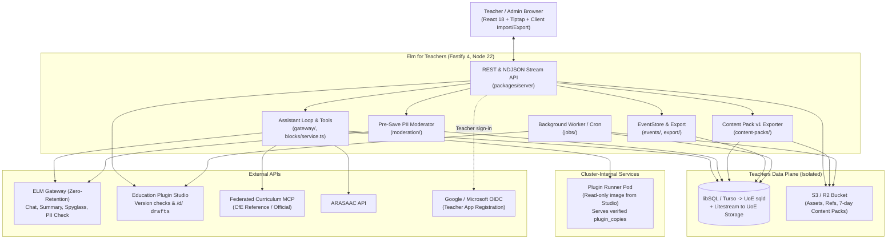
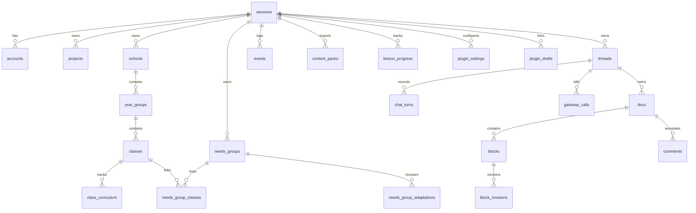

# Elm for Teachers — Product & Developer Specification

**Date:** 25 November 2026  
**Repository:** `ssfgreen/epistemic-differentiation-workshop` (evolved in place)  
**Legal Role:** University of Edinburgh as **Data Controller** (research study with consenting teachers)  
**Data Boundary:** Holds **zero new pupil personal data** and zero pupil-facing routes.

---

## 1. Product Specification

### 1.1 Purpose & Users

Elm for Teachers is a research-instrumented AI worksheet and lesson-material authoring environment for teachers.

- **Teachers (Study Participants & Pilot Users):** Reach a personal workspace via a secret study link (`/s/<token>` or access code) or Google/Microsoft sign-in (`/w`). Create projects, manage classes and generic **Needs Groups**, attach curriculum standards, author worksheets with an AI assistant that proposes tracked changes, connect plugins/drafts from Education Plugin Studio, complete teacher onboarding lessons, and export anonymised **Content Packs** to Elm for Students.
- **Researchers & Admins (`/admin`):** Create study workspaces, toggle per-workspace feature flags, enable time-bounded interaction logging, top up workspace budgets, export reproducible session zip bundles, and replay sessions (`/admin/replay`).

### 1.2 Core Product Capabilities

1. **Block-Based Worksheet Editor & Tracked Suggestions**
   - Local-first Tiptap editor over ordered top-level blocks (paragraphs, headings, block-per-item lists, tables with preserved header styling, writing lines `<line/>`, uploaded images, ARASAAC pictograms, drawn SVGs).
   - **Suggesting mode (default):** The assistant's edits appear as Word-style inline tracked changes with Accept/Reject cards in the comments column. Typing inside a suggestion keeps it pending.
   - **Editing mode (opt-in):** Commits changes directly into live blocks while preserving any concurrent teacher typing word-by-word and never silently overwriting an earlier turn's waiting suggestion.
   - **Word / PDF / PowerPoint import & export** in the browser, backed by `check_layout` A4 pagination checks.
   - **Spyglass** scope check after commits to alert teachers if an edit drifted outside what they asked.

2. **Needs Groups (Replacing Per-Pupil Tables)**
   - Replaces individual pupil rows (`class_pupils` / `pupil_adaptations`) with reusable, generic learner groups (e.g., *"Dyslexia support"*, *"EAL scaffolding"*, *"Level 1 numeracy"*).
   - A needs group can be workspace-wide or attached to one or more classes (`needs_group_classes`) and carries curated pedagogy adaptations (`needs_group_adaptations`).
   - A teacher can start a chat scoped to a class, a year group, a needs group, or **a needs group within a class** (combining `class_id` + `needs_group_id` so the assistant receives both the class's curriculum and the group's adaptations).
   - **Pre-save PII Guardrail:** Saving `classes.note` or a `needs_groups` description runs deterministic PII checks plus a zero-retention ELM model check (`moderation_checks`), warning or blocking before pupil names or identifying details are stored.

3. **Curriculum Profiles & Pedagogy Grounding**
   - Teachers select a human-readable **Curriculum Profile** on a class (e.g., *Scotland → Curriculum for Excellence → Second Level → Numeracy & Mathematics*), stored in `classes.curriculum_profile`.
   - `class_curriculum` stores picked outcomes with `code`, `text`, `source_version`, `status` (`planned`/`now`/`done`), and a nullable `standard_uri` (CASE/JSON-LD UUID) for federated Curriculum MCP resolution.
   - Pedagogy grounding cites individual claims (`[[clm-...]]`) from verified local plugin copies (`plugin_copies`) or live Studio drafts (`plugin_drafts`).

4. **One-Way Export to Elm for Students (Content Pack v1)**
   - From any document, the teacher clicks **Send to Elm for Students**, picks `reading` or `worksheet` (and optional suggested pupil prompt buttons), and receives a 7-day import link + SHA-256 hash.
   - The teacher can revoke a link at any time (deletes the object from storage and marks `revoked_at`).
   - No student activity, marks, or flags ever return to Elm for Teachers.

5. **Teacher Onboarding Lessons (`lesson_progress`)**
   - Interactive guidance lessons keyed on `session_id` (not `account_id`) so secret-link study participants (`/s/<token>`) and signed-in teachers share identical onboarding progress.

6. **Research Instrument & Replay**
   - Full structured event log (`events`), immutable `config_versions` snapshots (config, system prompt, skills), `gateway_calls` with stored `cost_gbp`, optional timed interaction tracking (pointer, clicks, viewport, selections), reproducible `/admin` zip export, and browser-based session replay.

---

## 2. System Architecture

### 2.1 Component Topology



### 2.2 Package & Runtime Layout

- **`packages/shared`**: Pure TypeScript Zod schemas, canvas state machine (`canvas.ts`, `apply.ts`), block/list/layout logic, event schemas (`events/`), research bundle manifest (`bundle.ts`), feature flags (`features.ts`), and the new **`contentPackV1.ts`** schema.
- **`packages/server`**: Fastify API, libSQL wrapper (`db/client.ts`, `db/types.ts`), background job runner (`worker.ts`), and standalone migration CLI (`migrate-cli.ts`).
  - *Current hosting:* Single Vercel serverless function (`api/index.mjs`, 300 s `maxDuration`) + Turso EU + Cloudflare R2.
  - *Target hosting:* UoE Kubernetes (`deploy/k8s/`): 2 app replicas serving API + built client, 1 `sqld` StatefulSet with Litestream sidecar replicating to University storage, 1 `runner` Deployment (network-isolated via `NetworkPolicy`), and a `migrate` Job run before rollout.
- **`packages/client`**: Vite, React 18, Tailwind v4, Tiptap canvas editor, Workspace / Projects / Classes & Needs Groups / Pedagogy / Plugins / Admin / Replay screens. All pupil screens (`screens/pupil/`, `reader/`) are removed in Phase 3.
- **`packages/evals`**: Deterministic judge suite against live ELM models (`pnpm eval`), updated alongside the `needs_groups` migration.

### 2.3 Architectural Rules & Guardrails

1. **The assistant suggests; the teacher decides** (dated exceptions in `docs/rules.md`: Editing mode, new/copied docs, blank docs).
2. **One write path for docs and blocks** (`server/src/blocks/service.ts` + `shared/src/canvas.ts`).
3. **A chat sees only its own docs, history, and summary** (`gateway/view.ts`).
4. **Everything teacher-side is logged under a hash** (`EventStore`, `config_versions`), **except** `moderation_checks` (blocked text is never stored or logged to `events`).
5. **The research data format is stable** (`shared/src/events/`, `shared/src/bundle.ts`). Any schema change to exported files requires an explicit export version bump and Sam's sign-off.
6. **Zero-pupil CI guardrail:** Automated server test asserts zero `/api/pupil/*` or `/r/*` routes exist, `PUPILS` env/feature paths are gone, and zero code paths write to any dropped pupil table.
7. **Zero-retention PII check:** Model-based PII moderation calls *must* verify `provider.zero_retention === true` (failing closed to deterministic-only or refusing save if unset) so accidentally pasted names are never sent to a retaining provider.
8. **Migrations are append-only:** Run as a pre-rollout step (`migrate-cli.ts`); `/api/health/ready` returns 200 only when the DB answers and zero migrations are pending.

---

## 3. Data Architecture (35 Target Tables)

Root entity remains **`sessions` (`session_id`)**, preserving all active study data, existing migrations (`0004`–`0051`), and workspace deletion (`SESSION_TABLES`). All IDs are `TEXT` (ULID/UUID), timestamps are ISO 8601 `TEXT`, JSON columns are `TEXT`, and booleans are `INTEGER CHECK (x IN (0, 1))`.

### 3.1 Entity-Relationship Overview



### 3.2 Kept Tables (28 Tables — With Targeted Column Changes)

| Group | Tables | Changes in Split |
| :--- | :--- | :--- |
| **Workspaces & Auth** | `sessions`, `config_versions`, `accounts`, `sign_ins`, `account_invites`, `preferences` | `sessions.features` drops `pupils` (legacy JSON ignored safely by `resolveFeatures`) and optionally adds `needs_groups` during study transition. |
| **Authoring & Chat** | `projects`, `threads`, `docs`, `blocks`, `block_revisions`, `block_splits`, `comments`, `assets`, `reference_files`, `reference_pages`, `chat_turns` | `threads` adds nullable `needs_group_id TEXT REFERENCES needs_groups(id)`. A thread may hold at most one of `(project_id, year_group_id, class_id)` — **and** `needs_group_id` may be set either alone or alongside `class_id`. |
| **Research & Billing** | `events`, `gateway_calls`, `budget_topups`, `jobs` | `jobs` gains `expire_content_pack` and `sync_plugin_copies` job kinds. |
| **Classes & Curriculum** | `schools`, `year_groups`, `classes`, `class_curriculum` | `classes` reuses existing `note` column (no duplicate `context` column), adds `note_check_id TEXT REFERENCES moderation_checks(id)` and nullable `curriculum_profile TEXT` (JSON: `{ jurisdiction, framework, level, subject, mcp_endpoint }`), and drops `reader_follow_ups_max`, `reader_pupil_budget_gbp`, `reader_safety_instruction`. `class_curriculum` adds nullable `standard_uri TEXT`. |
| **Plugins** | `plugin_settings`, `plugin_grants`, `plugin_drafts` | Unchanged; `plugin_settings` references pinned versions held in `plugin_copies`. |

### 3.3 New Tables (7 Tables)

#### 1. `needs_groups`
Generic or class-assigned learner support profiles replacing individual pupil rows.
```sql
CREATE TABLE needs_groups (
  id TEXT PRIMARY KEY,
  session_id TEXT NOT NULL REFERENCES sessions(session_id),
  name TEXT NOT NULL,
  description TEXT,
  what_helps TEXT,
  check_id TEXT REFERENCES moderation_checks(id),
  position INTEGER NOT NULL DEFAULT 0,
  created_at TEXT NOT NULL,
  updated_at TEXT NOT NULL,
  archived_at TEXT
);
CREATE INDEX idx_needs_groups_session ON needs_groups (session_id, position);
```

#### 2. `needs_group_classes`
Many-to-many join attaching a needs group to one or more classes (optional: a group with no rows here is workspace-wide).
```sql
CREATE TABLE needs_group_classes (
  needs_group_id TEXT NOT NULL REFERENCES needs_groups(id),
  class_id TEXT NOT NULL REFERENCES classes(id),
  session_id TEXT NOT NULL REFERENCES sessions(session_id),
  created_at TEXT NOT NULL,
  PRIMARY KEY (needs_group_id, class_id)
);
CREATE INDEX idx_needs_group_classes_class ON needs_group_classes (session_id, class_id);
```

#### 3. `needs_group_adaptations`
Curated pedagogy entries chosen for a needs group (mirrors `pupil_adaptations` shape without any pupil ID).
```sql
CREATE TABLE needs_group_adaptations (
  id TEXT PRIMARY KEY,
  session_id TEXT NOT NULL REFERENCES sessions(session_id),
  needs_group_id TEXT NOT NULL REFERENCES needs_groups(id),
  entry_id TEXT NOT NULL,
  title TEXT NOT NULL,
  changes_goal INTEGER NOT NULL DEFAULT 0 CHECK (changes_goal IN (0, 1)),
  status TEXT NOT NULL CHECK (status IN ('confirmed', 'trialling', 'stopped')),
  overrides TEXT,
  source_version TEXT,
  created_at TEXT NOT NULL,
  updated_at TEXT NOT NULL,
  removed_at TEXT
);
CREATE INDEX idx_needs_group_adaptations_group ON needs_group_adaptations (needs_group_id);
```

#### 4. `moderation_checks`
Audit trail of deterministic + zero-retention model PII checks on teacher free-text fields (`classes.note`, `needs_groups`). **Never stores the blocked text; never exported in research bundles.**
```sql
CREATE TABLE moderation_checks (
  id TEXT PRIMARY KEY,
  session_id TEXT NOT NULL REFERENCES sessions(session_id),
  target_kind TEXT NOT NULL CHECK (target_kind IN ('class_note', 'needs_group')),
  target_id TEXT NOT NULL,
  text_hash TEXT NOT NULL,
  verdict TEXT NOT NULL CHECK (verdict IN ('allowed', 'redacted', 'blocked')),
  categories TEXT NOT NULL DEFAULT '[]',
  redactions TEXT NOT NULL DEFAULT '[]',
  model TEXT,
  policy_version TEXT NOT NULL,
  cost_gbp REAL,
  created_at TEXT NOT NULL
);
CREATE INDEX idx_moderation_checks_target ON moderation_checks (session_id, target_kind, target_id);
```

#### 5. `content_packs`
Tracks frozen one-way bundles written to object storage for transfer to Elm for Students.
```sql
CREATE TABLE content_packs (
  id TEXT PRIMARY KEY,
  session_id TEXT NOT NULL REFERENCES sessions(session_id),
  doc_id TEXT NOT NULL REFERENCES docs(id),
  kind TEXT NOT NULL CHECK (kind IN ('reading', 'worksheet')),
  title TEXT NOT NULL,
  format_version TEXT NOT NULL DEFAULT '1.0',
  content_hash TEXT NOT NULL,
  storage_key TEXT NOT NULL,
  bytes INTEGER NOT NULL,
  link_code_hash TEXT NOT NULL UNIQUE,
  created_at TEXT NOT NULL,
  expires_at TEXT NOT NULL,
  revoked_at TEXT
);
CREATE INDEX idx_content_packs_session ON content_packs (session_id, created_at);
CREATE INDEX idx_content_packs_expires ON content_packs (expires_at);
```
*(Note: `fetched_at` is intentionally omitted to uphold the strictly one-way flow and link-scanner resilience — `GET` never mutates state, and Elm for Students sends no callback.)*

#### 6. `lesson_progress`
Teacher onboarding lesson state, keyed by `session_id` so both `/s/<token>` and `/w` users are supported.
```sql
CREATE TABLE lesson_progress (
  session_id TEXT NOT NULL REFERENCES sessions(session_id),
  lesson_id TEXT NOT NULL,
  status TEXT NOT NULL CHECK (status IN ('started', 'completed', 'dismissed')),
  state_json TEXT,
  updated_at TEXT NOT NULL,
  completed_at TEXT,
  PRIMARY KEY (session_id, lesson_id)
);
```

#### 7. `plugin_copies`
Workspace-independent local cache of verified published plugin archives fetched from Education Plugin Studio and served by the internal runner pod.
```sql
CREATE TABLE plugin_copies (
  plugin_id TEXT NOT NULL,
  version TEXT NOT NULL,
  content_hash TEXT NOT NULL,
  storage_key TEXT NOT NULL,
  manifest_json TEXT NOT NULL,
  passport_json TEXT,
  withdrawn_at TEXT,
  fetched_at TEXT NOT NULL,
  checked_at TEXT NOT NULL,
  PRIMARY KEY (plugin_id, version)
);
```

### 3.4 Dropped Tables (15 Tables — Dropped Last in Phase 4)

1. **Dormant pupil & reader tables (12 tables — dropped first):** `reader_ask_texts`, `reader_asks`, `reader_highlights`, `reading_prompts`, `readings`, `reader_prompts`, `pupil_logins`, `removed_pupils`, `class_members`, `class_codes`, `pupil_sign_ins`, `pupils`.
2. **Legacy study/design tables (3 tables — dropped after archival & export guard):** `make_boards`, `pupil_adaptations`, `class_pupils`.

Before dropping `make_boards` and `class_pupils`, guard their reads in [`export/bundle.ts`](../../packages/server/src/export/bundle.ts) and [`classes/bundle.ts`](../../packages/server/src/classes/bundle.ts) using `sqlite_master` checks (matching the existing `pupil_adaptations` guard), bump the bundle schema version, and update `SESSION_TABLES` in [`sessions/service.ts`](../../packages/server/src/sessions/service.ts).

---

## 4. Server Modules & API Changes

### 4.1 New Modules (`packages/server/src/`)
- `needs-groups/`: CRUD for `needs_groups`, `needs_group_classes`, `needs_group_adaptations`; feeds `gateway/class-message.ts` and `gateway/pedagogy-message.ts`.
- `moderation/`: Deterministic PII detector (emails, postcodes, UK phone numbers, common name-list / DOB patterns) + zero-retention ELM classifier; writes `moderation_checks` only (never `events`).
- `content-packs/`: Builds Content Pack v1 zip from `liveBlocks()`, embeds referenced assets from bucket/DB, verifies exclusion invariants, uploads zip to bucket, creates `link_code_hash`, serves `GET /api/packs/:code` (302 to short-lived presigned R2 URL, `Cache-Control: no-store`, never burns code), and revokes (marks `revoked_at` + deletes object).
- `lessons/`: `GET /api/sessions/:id/lessons`, `PUT /api/sessions/:id/lessons/:lessonId`.
- `plugin-copies/`: Syncs published plugin versions from Studio, verifies SHA-256 `content_hash` and `passport.json`, stores locally for the internal runner pod, and removes copies when Studio marks a version withdrawn.
- `curriculum-mcp/`: Client adapter calling a class's configured Curriculum MCP server (`resolve_standard`, `get_prerequisites`, `get_benchmarks`, `get_misconceptions`), falling back to the bundled CfE collection until the reference MCP server is live.

### 4.2 Removed Modules (Phase 3–4)
- Server: `pupils/`, `class-joins/`, `pupil-logins/`, `reader/`, `reader-prompts/`, `readings/`, `reader-asks/`, `classes/reader-settings*.ts`, `make/`.
- Client: `screens/pupil/`, `reader/`, pupil option in `WhoScreen.tsx`.

### 4.3 New / Changed HTTP Endpoints

| Method & Path | Auth | Purpose |
| :--- | :--- | :--- |
| `GET/POST/PATCH/DELETE /api/sessions/:id/needs-groups/...` | `requireParticipant` | Manage needs groups, class attachments, and adaptations (runs PII moderation on write). |
| `POST /api/sessions/:id/docs/:docId/content-packs` | `requireParticipant` | Build and upload a Content Pack v1 zip; returns `{ pack_id, content_hash, import_url, expires_at }`. |
| `GET /api/sessions/:id/content-packs` | `requireParticipant` | List exported packs for the workspace. |
| `DELETE /api/sessions/:id/content-packs/:packId` | `requireParticipant` | Revoke link (`revoked_at`) and delete object from bucket. |
| `GET /api/packs/:code` | Capability link (`link_code_hash`) | Checks expiry & revocation; 302 redirect to 60 s presigned GET URL; 404/410 otherwise. |
| `GET/PUT /api/sessions/:id/lessons[/:lessonId]` | `requireParticipant` | Read/update teacher onboarding lesson progress. |

---

## 5. Verification & Testing Plan

- **Contract tests:** Exporter against `content-pack-v1.schema.ts` and the two golden fixtures; negative assertions proving teacher email, `session_id`, `doc_id`, comments, pending suggestions, and revisions are stripped.
- **Zero-pupil CI guardrail:** Automated check across registered Fastify routes and server source asserting zero pupil routes and zero writes to pupil tables.
- **PII moderation tests:** Unit tests for deterministic + mocked ELM checks; refusal test proving moderation fails closed when `provider.zero_retention` is false; test proving blocked text never appears in `moderation_checks`, `events`, or logs.
- **Research export tests:** Confirm historical workspaces export cleanly before and after Phase 4 cleanup; confirm `moderation_checks` and `content_packs` link codes never appear in research bundles.
- **Standard checks:** `pnpm check`, `bash scripts/ci.sh`, and Playwright e2e (including needs-group workflow and Content Pack export).

---

## 6. Sequenced Development Plan (`epistemic-differentiation-workshop`)

Each milestone ships as small, reviewable PRs into `development` passing `bash scripts/ci.sh` (`pnpm check`, build, live integration, Playwright e2e). Structural refactors (for files over 400 lines) land in separate commits ahead of behaviour changes.

| ID | Milestone | Depends On | Key Deliverables & Migrations | Exit Criteria / Verification |
| :--- | :--- | :--- | :--- | :--- |
| **T0** | **Content Pack (v1) Contract & Golden Fixtures** | — | `packages/shared/src/contentPackV1.ts` (Zod schema + deterministic hash spec); two golden zip fixtures (`reading-with-image.zip`, `worksheet-with-prompts.zip`) in `fixtures/contracts/`; pure pack builder over `liveBlocks()`. | Deterministic SHA-256 passes across runs; negative tests prove zero `session_id`, teacher email, `doc_id`, comments, revisions, or pending suggestions appear in pack bytes. *(Unblocks Elm for Students seed.)* |
| **T1** | **Needs Groups Schema & Feature-Gated UI** | — | Migration `0052_needs_groups.sql` (`needs_groups`, `needs_group_classes`, `needs_group_adaptations`, `threads.needs_group_id`); add `needs_groups` flag to `shared/src/features.ts`; `server/src/needs-groups/`; update `threads/service.ts` to allow `class_id + needs_group_id`; update `gateway/class-message.ts` & `pedagogy-message.ts`; Needs Groups client screen. | Existing study cohorts continue unaffected with flag off; with flag on, class + needs-group chats inject both curriculum and group adaptations; `SESSION_TABLES` and `delete.test.ts` updated. |
| **T2** | **Pre-Save Zero-Retention PII Moderation** | T1 | Migration `0053_moderation_checks.sql` (`moderation_checks`, `classes.note_check_id`, `needs_groups.check_id`); `server/src/moderation/` (deterministic rules + zero-retention ELM classifier); wire pre-save checks into `classes` and `needs-groups` write routes with teacher warning/redaction UI. | Fails closed if `provider.zero_retention` is false; blocked text never lands in DB, `events`, or logs; unit + integration tests cover allowed, redacted, and blocked verdicts. |
| **T3** | **One-Way Content Pack Exporter** | T0 | Migration `0054_content_packs.sql` (`content_packs`); `server/src/content-packs/` (zip builder pulling bucket/DB assets, R2 upload, `link_code_hash`, `GET /api/packs/:code` 302 redirect, `DELETE` revoke + bucket delete); `expire_content_pack` job in `server/src/jobs/`; **Send to Elm for Students** modal in editor. | `GET /api/packs/:code` never burns code (idempotent for Safe Links); revoked link returns 404/410 and deletes bucket object; zero outbound calls to Elm for Students; e2e export + revoke test green. |
| **T4** | **Onboarding Lessons & Curriculum Profile Hooks** | T1 | Migration `0055_lessons_curriculum_hooks.sql` (`lesson_progress`, `classes.curriculum_profile`, `class_curriculum.standard_uri`); `server/src/lessons/`; onboarding progress UI working on both `/s/<token>` and `/w`. | Secret-link and signed-in teachers persist lesson state by `session_id`; existing `class_curriculum` flows unchanged with nullable `standard_uri`. |
| **T5** | **Local `plugin_copies` & Studio Runner Cutover** | Studio P0, P1 | Migration `0056_plugin_copies.sql` (`plugin_copies`); `server/src/plugin-copies/` sync job (fetches immutable archives from Studio, checks SHA-256 + `passport.json`, drops withdrawn versions); switch `deploy/k8s/runner.yaml` from local `edw-runner` to Studio's digest-pinned GHCR runner image. | Assistant answers from local verified copy with outbound Studio access blocked; withdrawn version removed on sync. |
| **T6** | **Remove Pupil Routes & Zero-Pupil CI Guardrail** | T3, Students Gate C | Remove `pupils/`, `class-joins/`, `pupil-logins/`, `reader/`, `reader-prompts/`, `readings/`, `reader-asks/`, `classes/reader-settings*.ts`, `client/src/reader/`, `client/src/screens/pupil/`, and pupil option in `WhoScreen.tsx`; add CI test asserting zero `/api/pupil/*` or `/r/*` routes and zero writes to legacy pupil tables. | `routes.test.ts` updated; zero-pupil CI guardrail green; all teacher e2e specs pass. *(Keep dormant tables until T7 archival.)* |
| **T7** | **Study Cutover, Export Guard & 15-Table Cleanup** | T6, Study Archival | Switch demo seed (`P7A`) and `packages/evals` to `needs_groups` + run `pnpm eval`; download and verify full Turso backup + archive completed study bundles; add `sqlite_master` guards for `make_boards` and `class_pupils` in `export/bundle.ts` & `classes/bundle.ts` + bump export version; migration `0057_drop_legacy_tables.sql` dropping 15 legacy tables and `classes.reader_*`; remove `PUPIL_TABLES` and update `SESSION_TABLES`; scrub/archive historical `gateway_calls` pupil rows. | Live DB reaches exact 35-table schema; historical and new research exports both pass `rebuild.ts`; `pnpm eval` baseline updated and reviewed by Sam. |
| **T8** | **UoE Kubernetes Cutover & Federated Curriculum MCP** | T5, T7, Studio P6 | Migrate Turso → UoE `sqld` + Litestream (verified by comparing every workspace export before/after); add `server/src/curriculum-mcp/` client reading `classes.curriculum_profile`; cut over CfE lookup from bundled collection to Reference Curriculum MCP server. | Export diff zero before/after DB migration; `GET /api/health/ready` green on UoE K8s; teacher selects CfE profile without touching URLs/JSON. |
