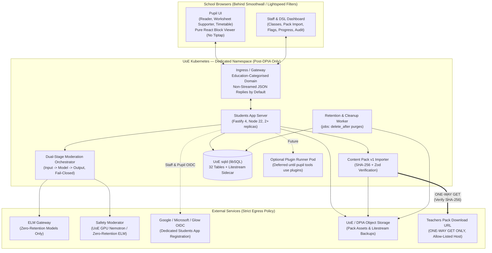
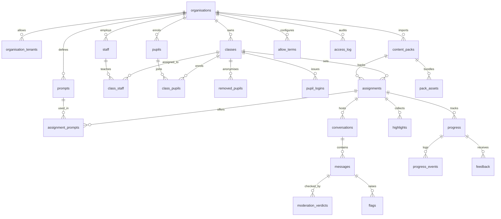
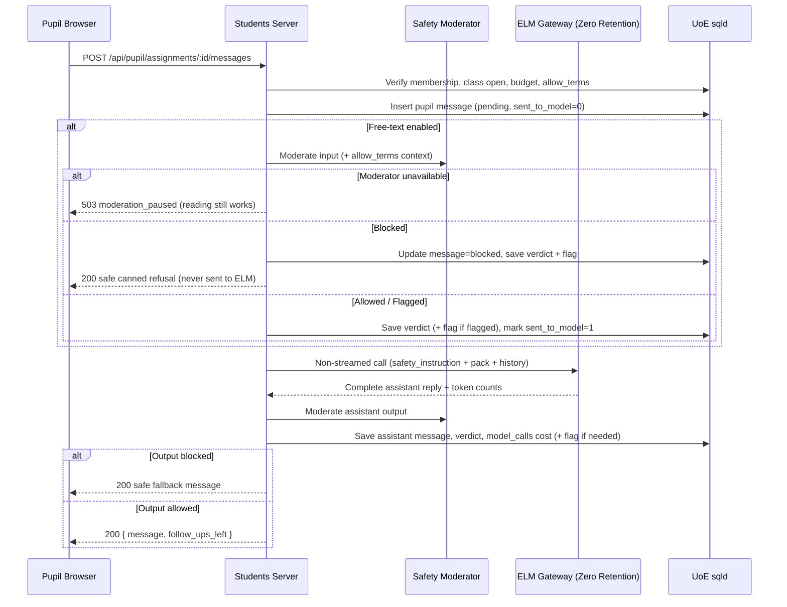

# Elm for Students — Product & Developer Specification

**Date:** 25 November 2026  
**Repository:** `ssfgreen/elm-for-students` (greenfield clean-room repo; no legacy Git history or migrations)  
**Legal Role:** School / Local Authority as **Data Controller**; University of Edinburgh as **Data Processor**  
**Data Boundary:** Holds pupil identities, transcripts, moderation verdicts, and safeguarding flags. **Never collects research data. Never communicates back to Elm for Teachers.**

---

## 1. Product Specification

### 1.1 Purpose & Users

Elm for Students is a safeguarding-first suite of AI learning tools for school pupils, owned at the **school (`organisations`)** level so classes, assignments, and retention schedules persist even if an individual teacher leaves.

- **Pupils:** Sign in with school SSO (Google Workspace, Microsoft Entra ID / Glow) or a teacher-generated login (`green-otter-27` + passphrase), join classes by join code, and use teacher-assigned AI tools.
- **Teachers & Support Staff (`staff` / `class_staff`):** Import anonymised **Content Packs (v1)** from Elm for Teachers, manage classes, configure safety rules/budgets/prompts, toggle free-text chat per assignment, review pupil progress and moderation flags, add false-positive `allow_terms` (e.g. *"To Kill a Mockingbird"*), and release feedback.
- **School Admins & Designated Safeguarding Leads (DSLs):** Manage school tenant allow-lists (`organisation_tenants`), retention windows (`retention_days`), `safeguarding_contact` routing, staff memberships, safeguarding flag escalations, and audit trails (`access_log`).

### 1.2 Core Learning Tools (Assignments)

Every piece of pupil work is an **`assignment`** inside a class with a tool type (`reader`, `worksheet_supporter`, or `timetable_helper`), optional imported `content_pack`, optional schedule (`opens_at`, `due_at`, `closes_at`), `free_text` toggle (off by default), and allowed prompt buttons:

1. **Reader (`reader`):** Renders a frozen reading block-by-block (pure React, no Tiptap), lets pupils highlight passages with categories, and ask questions via teacher-approved prompt buttons (plus optional moderated free-text follow-ups when enabled by the teacher).
2. **Worksheet Supporter (`worksheet_supporter`):** Renders an imported worksheet Content Pack (including `<line/>` writing-line slots, tables, and images), offering Socratic scaffolding and hints without giving away answers, with progress tracking (`progress`, `progress_events`) and teacher-reviewed `feedback`.
3. **Timetable Helper (`timetable_helper`):** Structured executive-function and daily schedule support for pupils without requiring a Content Pack.

### 1.3 Safeguarding & Oversight Capabilities

- **Dual-Stage Moderation Pipeline:**
  - *Input moderation (pre-model):* Runs on all pupil free-text messages before any text is sent to the assistant model (`messages.sent_to_model = 0` if blocked). Checks `allow_terms` (school-wide or class-level false-positive overrides) so curriculum texts are not misflagged.
  - *Output moderation (post-model, pre-display):* Runs on the full assistant reply **before** it is returned to the pupil's browser. Because replies are **non-streamed by default**, unsafe output is never partially flushed to the screen.
  - *Graceful Pause State:* If the moderator service is unreachable or errors, free-text chat pauses cleanly with a child-friendly notice; reading and highlighting continue uninterrupted.
- **Severity & Flag Triage:** Verdicts create `flags` at three severities: `off_task`, `concern`, and `safeguarding`. Staff review, resolve, or escalate flags (`escalated_to`), with every review recorded in `access_log`.
- **Teacher Controls per Class:** Join code management, `tenant_locked` enforcement, `follow_ups_max`, `pupil_budget_gbp`, class `safety_instruction`, and class archival/retention dates (`delete_after`).
- **Audited Oversight (`access_log`):** Logs every staff view of pupil transcripts, flag review, export, and deletion — IDs and actions only, never message text.

---

## 2. System Architecture

### 2.1 Component Topology

### 2.2 Key Engineering Choices

- **Rooted in `organisations` (zero `sessions`):** Every data query is strictly scoped by `organisation_id` (enforced by store signatures and repository tests). Multi-school staff (supply teachers, council specialists) are supported via `UNIQUE(organisation_id, provider, subject)` on `staff`.
- **Glow (Scotland National Entra ID Tenant) Support:** `organisation_tenants` acts as an allow-list and never assumes a 1-to-1 tenant-to-school mapping. Because Glow uses one national tenant ID for all Scottish schools, Glow staff bind via school invite links and Glow pupils bind via `classes.join_code` (with `classes.tenant_locked` optionally restricting joins to allowed school tenants).
- **Non-Streamed Replies by Default:** Matches the existing `reader-asks` architecture (`provider.respond` returning whole JSON). Eliminates SSE buffering failures on school web filters (Smoothwall, Lightspeed) **and** guarantees complete post-generation output moderation before display.
- **No Tiptap in Pupil Client:** Reuses Elm's pure-React `ReadingBlocks.tsx` + `readerText.ts` renderer, keeping the pupil bundle tiny, accessible, and safe (SVGs rendered as sanitised ``, never inline HTML).
- **Plugin Runner Deferred for v1:** `plugin_copies` is present in the schema for future curriculum/pedagogy-aware pupil tools, but v1 deploys without a Plugin Runner pod until a pupil tool actually calls one, keeping the DPIA and cluster footprint minimal.

### 2.3 Cherry-Picked Modules from Elm (Phase 2 Seed)

Every copied file carries a header naming its source path and commit in `ssfgreen/epistemic-differentiation-workshop`:

| Source in Elm | Destination in `elm-for-students` | Adaptation Required |
| :--- | :--- | :--- |
| `server/src/accounts/{oidc,providers,cookies}.ts` | `server/src/auth/` | Rewire to `staff`/`pupils` and `organisation_tenants`; set pupil OIDC scope to `openid profile` (display name, no email). |
| `server/src/pupil-logins/{words,hash}.ts` | `server/src/pupil-logins/` | Keep globally unique `username` so pupils do not need to pick a school at login; add optional teacher-entered `display_name`. |
| `server/src/gateway/{elm,calls,errors}.ts` | `server/src/ai/` | Point cost/token logging to `model_calls`; require `zero_retention: true`; remove teacher agent tools. |
| `server/src/reader-asks/{article,request}.ts` | `server/src/tools/reader/` | Keep fence stripping and highlight validation; extend for moderated free-text + `conversations`/`messages`. |
| `shared/src/{readerText,lists,svg}.ts` | `shared/src/` | Copy verbatim; add `contentPackV1.ts` contract schema. |
| `client/src/reader/` & `client/src/screens/pupil/` | `client/src/reader/`, `client/src/pupil/` | Adapt API calls to `/api/pupil/assignments/...` and `conversations`/`messages`. |
| `deploy/k8s/{sqld,litestream*,migrate-job,network-policies}.yaml` | `deploy/k8s/` | Dedicated namespace, UoE backup bucket, egress policies (excluding Elm for Teachers except pack download allow-list). |

**Explicitly left behind (never copied):** `events/`, `export/`, `blocks/` write path, Tiptap `editor/`, `make/`, `sessions/`, `classes/pupil-scrub.ts`, `gateway/agent.ts`, and all 51 legacy migrations.

---

## 3. Data Architecture (32 Tables — Greenfield `0001_init.sql`)

All tables live in a single clean `0001_init.sql` (PostgreSQL-compatible libSQL). Every tenant-owned table includes `organisation_id` so row-level authorisation and retention deletes stay simple and auditable.

### 3.1 Entity-Relationship Overview

### 3.2 Complete 32-Table Schema Blueprint

#### Group 1: Schools & People (7 Tables)
1. **`organisations`**: `id`, `name`, `slug` (UNIQUE), `retention_days` (INTEGER NOT NULL), `safeguarding_contact` (TEXT JSON: DSL name/email/routing), `budget_gbp` (REAL NOT NULL), `created_at`, `archived_at`.
2. **`organisation_tenants`**: `id`, `organisation_id` (FK), `provider` (`google` | `microsoft`), `tenant_id` (Entra `tid` or Google `hd`), `label`, `created_at`. *(Non-unique on `tenant_id` so multiple Scottish schools can allow-list the single national Glow tenant.)*
3. **`staff`**: `id`, `organisation_id` (FK), `provider`, `subject`, `email`, `display_name`, `role` (`teacher` | `dsl` | `admin`), `created_at`, `last_sign_in_at`, `disabled_at`. **`UNIQUE(organisation_id, provider, subject)`**.
4. **`staff_sign_ins`**: `id_hash` (PK), `staff_id` (FK), `organisation_id` (FK), `created_at`, `expires_at`.
5. **`pupils`**: `id`, `organisation_id` (FK), `provider` (`google` | `microsoft` | `login`), `subject`, `tenant`, `display_name` (TEXT; SSO display name or teacher-entered name — **no pupil email stored**), `privacy_notice_version`, `created_at`, `last_sign_in_at`, `delete_after` (ISO 8601). `UNIQUE(organisation_id, provider, subject)`.
6. **`pupil_sign_ins`**: `id_hash` (PK), `pupil_id` (FK), `organisation_id` (FK), `password_hash_check` (TEXT, invalidates login sessions immediately on password reset), `created_at`, `expires_at`.
7. **`pupil_logins`**: `id`, `organisation_id` (FK), `class_id` (FK), `username` (**`TEXT NOT NULL UNIQUE`** globally, e.g. `green-otter-27`), `password_hash` (scrypt), `display_name` (nullable teacher-entered label/name), `pupil_id` (nullable FK to `pupils`), `wrong_tries` (INTEGER DEFAULT 0), `locked_at`, `created_at`, `used_at`.

#### Group 2: Classes (4 Tables)
8. **`classes`**: `id`, `organisation_id` (FK), `name`, `school_year`, `stage`, `subject`, `join_code` (nullable UNIQUE, canonical 8-char Crockford base32), `tenant_locked` (`INTEGER CHECK (tenant_locked IN (0, 1))`), `follow_ups_max` (INTEGER), `pupil_budget_gbp` (REAL), `safety_instruction` (TEXT), `created_at`, `archived_at`, `delete_after` (ISO 8601 NOT NULL).
9. **`class_staff`**: `class_id` (FK), `staff_id` (FK), `organisation_id` (FK), `role` (`owner` | `teacher` | `support`), `created_at`. `PRIMARY KEY (class_id, staff_id)`.
10. **`class_pupils`**: `id`, `organisation_id` (FK), `class_id` (FK), `pupil_id` (FK), `role` (`pupil` | `teacher_test`), `number` (INTEGER), `joined_at`. `UNIQUE(class_id, pupil_id)`, `UNIQUE(class_id, number)`, partial unique index for at most one `teacher_test` per class.
11. **`removed_pupils`**: `id`, `organisation_id` (FK), `class_id` (FK), `removed_on`, `delete_after` (mirrors `classes.delete_after`).
    - *GDPR Erasure Rule:* When a pupil is removed from a class, `class_pupils` and (if last class) `pupils` + `pupil_sign_ins` + `pupil_logins` are deleted. Button-only highlights/conversations may be re-keyed to `removed_pupils.id` and purged on `classes.delete_after`. For **free-text** assignments, either delete `messages` immediately on removal (retaining `model_calls` costs and any open safeguarding `flags` under a short hold) or confirm with UoE Data Protection that `classes.delete_after` satisfies erasure expectations.

#### Group 3: Content & Assignments (5 Tables)
12. **`content_packs`**: `id`, `organisation_id` (FK), `pack_id` (from `manifest.json`), `format_version`, `kind` (`reading` | `worksheet`), `title`, `subject`, `stage`, `standard_uris` (TEXT JSON array), `blocks_json` (TEXT), `content_hash`, `imported_by_staff_id` (FK), `imported_at`. **`UNIQUE(organisation_id, pack_id)`**.
13. **`pack_assets`**: `id`, `organisation_id` (FK), `content_pack_id` (FK), `asset_id`, `mime`, `bytes`, `sha256`, `storage_key`, `created_at`. `UNIQUE(content_pack_id, asset_id)`.
14. **`prompts`**: `id`, `organisation_id` (FK), `created_by_staff_id` (nullable FK), `label`, `instruction`, `after_highlight` (0/1), `follow_up` (0/1), `source` (`default` | `teacher` | `pack`), `position`, `created_at`, `updated_at`, `removed_at`.
15. **`assignments`**: `id`, `organisation_id` (FK), `class_id` (FK), `tool` (`reader` | `worksheet_supporter` | `timetable_helper`), `content_pack_id` (nullable FK), `title`, `free_text` (`INTEGER NOT NULL DEFAULT 0 CHECK (free_text IN (0, 1))`), `follow_ups_max` (nullable INTEGER), `opens_at`, `due_at`, `closes_at`, `created_by_staff_id` (FK), `created_at`, `updated_at`, `archived_at`.
16. **`assignment_prompts`**: `assignment_id` (FK), `prompt_id` (FK), `organisation_id` (FK), `position`, `PRIMARY KEY (assignment_id, prompt_id)`.

#### Group 4: Pupil Activity (7 Tables)
17. **`conversations`**: `id`, `organisation_id` (FK), `class_id` (FK — denormalised for fast teacher dashboard queries & class-level auth checks), `assignment_id` (FK), `member_id` (TEXT, no FK so `removed_pupils` re-keying works cleanly), `created_at`, `updated_at`. Index on `(organisation_id, class_id, updated_at)`.
18. **`messages`**: `id`, `organisation_id` (FK), `conversation_id` (FK), `role` (`pupil` | `assistant`), `prompt_id` (nullable FK), `highlighted_text` (nullable TEXT), `body` (TEXT), `moderation_state` (`pending` | `allowed` | `flagged` | `blocked`), `sent_to_model` (`INTEGER NOT NULL DEFAULT 0 CHECK (sent_to_model IN (0, 1))`), `created_at`.
19. **`highlights`**: `id`, `organisation_id` (FK), `class_id` (FK), `assignment_id` (FK), `member_id` (TEXT), `block_id`, `start` (INTEGER >= 0), `"end"` (INTEGER > `start`), `category`, `created_at`.
20. **`model_calls`**: `id`, `organisation_id` (FK), `class_id` (FK), `assignment_id` (nullable FK), `conversation_id` (nullable FK), `member_id` (nullable TEXT), `purpose` (`reply` | `moderation` | `feedback_draft`), `model`, `input_tokens`, `output_tokens`, `cached_tokens`, `cache_write_tokens`, `cost_gbp` (REAL), `config_hash`, `safety_hash`, `created_at`. *(Accountability & budget tracking only — zero message text, never exported as research.)*
21. **`progress`**: `id`, `organisation_id` (FK), `class_id` (FK), `assignment_id` (FK), `member_id` (TEXT), `status` (`not_started` | `in_progress` | `submitted` | `reviewed`), `answers_json` (TEXT), `submitted_at`, `updated_at`. `UNIQUE(assignment_id, member_id)`.
22. **`progress_events`**: `id`, `organisation_id` (FK), `progress_id` (FK), `event_kind` (`opened` | `step_completed` | `submitted` | `reopened`), `detail_json`, `created_at`.
23. **`feedback`**: `id`, `organisation_id` (FK), `progress_id` (FK), `author_staff_id` (nullable FK), `drafted_by_model` (0/1), `body`, `mark`, `released_at` (nullable — teacher releases feedback to pupil), `created_at`, `updated_at`.

#### Group 5: Moderation & Safeguarding (3 Tables)
24. **`allow_terms`**: `id`, `organisation_id` (FK), `class_id` (nullable FK — NULL = school-wide), `term`, `reason`, `added_by_staff_id` (FK), `created_at`, `removed_at`.
25. **`moderation_verdicts`**: `id`, `organisation_id` (FK), `message_id` (FK), `stage` (`input` | `output`), `model`, `policy_version`, `categories` (TEXT JSON), `on_task` (nullable 0/1), `score` (REAL), `verdict` (`allowed` | `flagged` | `blocked` | `error`), `latency_ms` (INTEGER), `created_at`.
26. **`flags`**: `id`, `organisation_id` (FK), `class_id` (FK), `message_id` (FK), `verdict_id` (FK), `severity` (`off_task` | `concern` | `safeguarding`), `status` (`open` | `reviewed` | `dismissed` | `escalated`), `reviewed_by_staff_id` (nullable FK), `review_note`, `escalated_to` (nullable TEXT), `created_at`, `reviewed_at`. Index on `(organisation_id, status, severity, created_at)`.

#### Group 6: Oversight & Running (6 Tables)
27. **`access_log`**: `id`, `organisation_id` (FK), `staff_id` (FK), `action` (`view_conversation` | `review_flag` | `escalate_flag` | `remove_pupil` | `export_record` | `delete_class`), `target_kind`, `target_id`, `created_at`. *(No message content.)*
28. **`onboarding_progress`**: `staff_id` (FK), `organisation_id` (FK), `step_id`, `completed_at`, `PRIMARY KEY (staff_id, step_id)`.
29. **`budget_topups`**: `id`, `organisation_id` (FK), `class_id` (nullable FK — NULL = organisation pool), `amount_gbp` (REAL), `at`, `via`.
30. **`plugin_copies`**: `plugin_id`, `version`, `content_hash`, `storage_key`, `manifest_json`, `passport_json`, `withdrawn_at`, `fetched_at`, `PRIMARY KEY (plugin_id, version)`. *(Populated only when pupil tools consume plugins.)*
31. **`config_versions`**: `hash` (PK), `kind` (`config` | `safety_policy` | `moderation_policy`), `content`, `first_seen_at`.
32. **`jobs`**: `id`, `kind` (`retention_purge_pupils` | `retention_purge_classes` | `retention_purge_access_log` | `cleanup_orphan_assets`), `payload`, `status`, `attempts`, `run_after`, `locked_until`, `last_error`, `created_at`, `finished_at`.

---

## 4. API Surface & Moderation Flow

### 4.1 Pupil Request Lifecycle (Moderated Non-Streamed Turn)

### 4.2 Core Route Groups

- **Auth (`/api/auth/*`, `/api/pupil/auth/*`, `/api/pupil/login`):** Separate staff and pupil cookies (`HttpOnly`, `SameSite=Lax`, `Secure`), CSRF `Origin` checks on all state-changing routes.
- **Staff & Safeguarding (`/api/staff/...`):** Classes, join codes, pupil logins, Content Pack preview & import (`POST /api/staff/content-packs/import`), assignments, `allow_terms`, flag triage queue (`GET/PATCH /api/staff/flags`), conversation viewer (writes `access_log`), progress & feedback release.
- **Pupil (`/api/pupil/...`):** Assignments list, frozen Content Pack blocks & signed/streamed `pack_assets`, highlights, moderated messages, progress submission, released feedback.

---

## 5. `AGENTS.md` Hard Boundaries & Verification Plan

The seeded repository's `AGENTS.md` enforces:
1. **Zero research tables or telemetry:** No `events` table, no keystroke/pointer tracking, no research exports.
2. **Zero outbound calls to Elm for Teachers** (except the explicit user-triggered one-way `GET` fetch of a Content Pack URL on an allow-listed host).
3. **Strict `organisation_id` scoping:** Every query takes `organisation_id`; cross-organisation IDs return 403/404 identically (no existence oracle).
4. **Fail-closed moderation & zero-retention:** Model calls refuse to run unless `zero_retention === true`; free-text chat pauses if the moderator fails.
5. **Required test suites:** Content Pack v1 golden fixture import tests (tampered hash rejected, oversized asset rejected, invalid MIME rejected), cross-tenant isolation tests, moderation input/output/fail-closed tests, retention job purge tests (`delete_after`), and Litestream backup/restore drill before any real pupil enters the system.

---

## 6. Sequenced Development Plan (`elm-for-students`)

Work is divided into **Track A (Clean-Room Seed by Sam, prior to handoff)**, **Track B (Product Build by the Student Developer)**, and **Track C (UoE Infrastructure & DPIA Go-Live)**.

### Track A — Clean-Room Seed (Sam, Pre-Handoff)

| ID | Milestone | Depends On | Key Deliverables | Exit Criteria / Verification |
| :--- | :--- | :--- | :--- | :--- |
| **S0** | **Clean-Room Repo, `0001_init.sql` & Boundaries** | Teachers T0 (Gate B) | Brand-new repo (no Git history, no legacy migrations); pnpm workspace (`shared`, `server`, `client`); `0001_init.sql` with all 32 `organisations`-rooted tables; `AGENTS.md` enforcing hard boundaries; copy `content-pack-v1.schema.ts` + both golden zip fixtures into `tests/contracts/`; CI workflow (`pnpm check`, build, Playwright). | `0001_init.sql` applies cleanly in libSQL and passes PostgreSQL syntax check; golden fixture contract tests green; lint/test guard asserts zero `events` table and zero cross-system imports. |
| **S1** | **Cherry-Picked Auth, Logins, AI Client & Pure-React Viewer** | S0 | Copy & rewire `auth/` (`oidc.ts`, `providers.ts`, `cookies.ts` → `staff`/`pupils`, `organisation_tenants` Glow allow-list, pupil scope `openid profile`), `pupil-logins/` (globally unique usernames + optional display name), `ai/` (non-streamed zero-retention ELM client → `model_calls`), pure-React `ReadingBlocks` + `readerText.ts` (no Tiptap), and K8s base manifests (`sqld`, `litestream`, `migrate-job`, `network-policies`, no runner pod yet). | Staff and pupil sign-in e2e pass against fake OIDC issuer (including multi-school staff and Glow shared-tenant scenario); pupil login lock/reset works; **Handoff Gate C** ready for Student developer. |

### Track B — Product Build (Student Developer, Post-Handoff)

| ID | Milestone | Depends On | Key Deliverables | Exit Criteria / Verification |
| :--- | :--- | :--- | :--- | :--- |
| **S2** | **Organisations, Classes & Content Pack Importer** | S1 (Gate C) | Staff CRUD for `classes`, `class_staff`, join codes (`tenant_locked`), `pupil_logins` batch generation, `prompts`; Content Pack v1 preview + import route (`POST /api/staff/content-packs/import`) fetching allow-listed URLs via one-way `GET`, verifying `content_hash` + per-file SHA-256 + Zod schema + MIME/size caps, storing `content_packs` + `pack_assets` in Students bucket. | Tampered hash, disallowed host, oversized zip, bad MIME, and duplicate `pack_id` all handled deterministically; cross-organisation access returns identical 403/404; zero outbound callbacks to Elm for Teachers. |
| **S3** | **Assignments, Pure-React Reader & Button-Only AI** | S2 | `assignments` + `assignment_prompts` CRUD; pupil dashboard & Reader screen rendering frozen `content_packs` blocks + `pack_assets` + highlights (`highlights`); non-streamed button-only AI turns writing `conversations`, `messages`, `model_calls` (with `pupil_budget_gbp` and `organisations.budget_gbp` + `budget_topups` checks). | Full teacher-import → pupil-join → highlight → prompt-ask e2e passes in Playwright; non-streamed JSON replies work cleanly behind a buffering reverse proxy; `model_calls` records zero message text. |
| **S4** | **Dual-Stage Moderation & Moderated Free-Text Chat** | S3, Governance #4 (Moderator Host) | `moderation/` orchestrator: input check (with school/class `allow_terms`) → fail-closed pause (`503 moderation_paused` when moderator down) → zero-retention ELM call → output check before display; writes `moderation_verdicts` and `flags` (`off_task` / `concern` / `safeguarding`); enable `assignments.free_text` toggle + pupil free-text composer. | Blocked input has `sent_to_model = 0` and never calls ELM; blocked output never reaches browser; `allow_terms` overrides false positives; moderator outage pauses free-text cleanly while reading/highlighting stay usable. |
| **S5** | **Safeguarding & Teacher Oversight Dashboard** | S4, Governance #3 (Escalation Policy) | Staff & DSL dashboard: flag triage queue (filter by severity/status, review, dismiss, escalate to `safeguarding_contact`), class conversation viewer, `allow_terms` manager, budget overview, `onboarding_progress`; every view/review/escalation writes `access_log` (IDs only, no message text). | Non-class staff cannot view class conversations (except school DSL/admin role); every staff transcript read and flag decision has a verified `access_log` row. |
| **S6** | **Worksheet Supporter & Timetable Helper** | S4 | **Worksheet Supporter:** renders `kind: "worksheet"` Content Packs including `<line/>` response slots, Socratic scaffolding, `progress` + `progress_events`, and teacher-drafted/released `feedback` (`released_at`). **Timetable Helper:** structured daily schedule tool without requiring a Content Pack. | Unreleased `feedback` is never visible to pupils; e2e covers worksheet completion, teacher review, and feedback release. |
| **S7** | **Scheduled Retention & GDPR Erasure Worker** | S5, S6, Governance #5 (Retention Defaults) | Background worker (`jobs`) executing `retention_purge_pupils`, `retention_purge_classes` (including `removed_pupils`, `conversations`, `messages`, `pack_assets`), and `retention_purge_access_log` on `delete_after`; pupil removal flow enforcing the agreed free-text erasure rule. | Automated tests advance clock past `delete_after` and assert complete purge of pupil PII, messages, removed-pupil records, and orphaned bucket assets while preserving non-PII `model_calls` totals if required. |

### Track C — Infrastructure, DPIA & Future Expansion

| ID | Milestone | Depends On | Key Deliverables | Exit Criteria / Verification |
| :--- | :--- | :--- | :--- | :--- |
| **S8** | **UoE Kubernetes Deployment & Post-DPIA Pilot Go-Live** | S7, Governance #1–5 | Dedicated UoE K8s namespace, `NetworkPolicy` isolation, education-categorised domain, separate Google/Microsoft/Glow OIDC app registrations, UoE `sqld` + Litestream continuous backup to University storage, disaster-recovery restore drill, school web-filter verification (Smoothwall/Lightspeed). | **Gate E:** Signed DPIA, verified Litestream restore from empty PVC, live school-filter test passed, first pilot school onboarded. |
| **S9** | **Optional v2: Plugin Runner Sidecar** | S8, Studio P0 | Deploy read-only Plugin Runner pod in Students namespace and enable `plugin_copies` sync only once a pupil tool requires pedagogy/curriculum plugins. | Runner pod has zero DB credentials and egress restricted by `NetworkPolicy`. |
