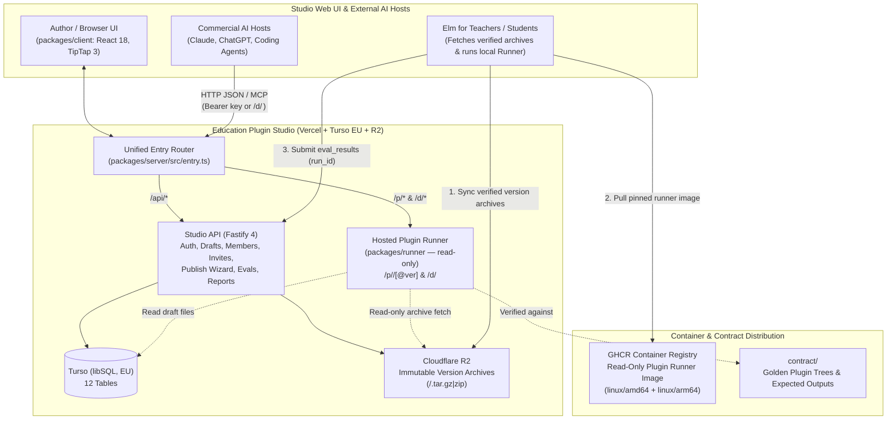
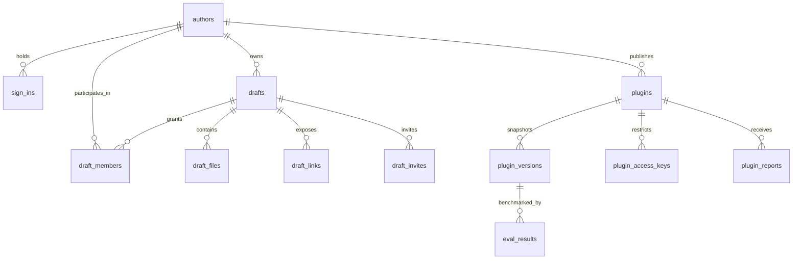

# Education Plugin Studio — Product & Developer Specification

**Date:** 25 November 2026  
**Repository:** `ssfgreen/education-plugin-studio`  
**Hosting:** Vercel + Turso (libSQL, EU) + Cloudflare R2 + GHCR (Runner Container Image)  
**Data Boundary:** Public/author platform. **Zero child data.** Runner never writes. Zero model calls on the platform in v1 (testing and evals run in hosts).

---

## 1. Product Specification

### 1.1 Purpose & Focus

Education Plugin Studio is a public platform for authoring, sharing, versioning, and evaluating **educational plugins** usable by any AI host (Elm for Teachers, Claude, ChatGPT, Gemini, coding agents) over HTTP JSON and MCP.

- **Strategic Knowledge Focus:** Plugin Studio focuses on **Pedagogy** (structured, evidence-backed teaching approaches, adaptations, format rules, cautions) and **Skills** (procedural AI instructions, workflows, rubrics, Socratic questioning, eval cases).
- **Curriculum Separation:** National curricula (e.g., Scotland's CfE, England's National Curriculum) belong to **Federated Curriculum MCP** servers using a CASE/JSON-LD layered knowledge graph rather than flat plugin folders. Plugin Studio supports lightweight local/school-specific schemes of work optionally, while Pedagogy entries reference statutory curriculum nodes by official code or URI (e.g. `MNU 2-07a`) without copying statutory text.

### 1.2 Users & Workflows

1. **Plugin Authors & Collaborators (`authors`, `draft_members`, `draft_invites`):**
   - Sign in with Google or Microsoft OIDC (or via a single-use draft invite link `/invite#<code>`).
   - Create blank drafts or copy an existing plugin (e.g., `elm/pedagogy`).
   - Edit pedagogy entries visually (title, summary, WYSIWYG Markdown body via TipTap 3, structured facets & evidence ratings, claims with ≤15-word quote checks) and skills (`SKILL.md`).
   - Share drafts with `owner`, `edit`, or `use` roles via invite links (codes shown once, stored hashed, kept in URL fragments only).
   - Generate a live draft link (`/d/<code>`) and click **Open in Elm** or copy the MCP URL for Claude/ChatGPT — zero API keys needed on the platform.
2. **Publishing & Passports (`plugins`, `plugin_versions`, `plugin_access_keys`):**
   - Publish immutable, semver-tagged snapshots (`v1.0.0`) with a deterministic SHA-256 `content_hash` and machine-readable `passport.json` + human-readable `PASSPORT.md`.
   - Three visibility levels: **`private`** (author only), **`limited`** (hashed access keys managed by the author), and **`public`** (listed in the public browser; requires complete, approved passport sections).
   - Automatic pre-publish checks reject child PII patterns, oversized quotes (>15 words), duplicate sources, and invalid manifests.
   - Authors or platform moderators can withdraw a version (`withdrawn_at`); connected hosts stop using withdrawn versions on their next sync and delete local copies.
3. **Host-Run Evals (`eval_results`):**
   - Authors define eval cases (`tests/*.yaml`) inside the draft.
   - Hosts (such as Elm for Teachers, on a made-up demo class) run a benchmark suite and submit structured outcomes grouped by **`run_id`** back to Plugin Studio, populating the passport's `tested_use` section with independent vs author-run labels.
4. **Moderation & Copyright Reports (`plugin_reports`):**
   - Public listings expose a report form for copyright, factual error, or safety concerns, triaged by Studio admins.

---

## 2. System Architecture

### 2.1 Component Topology



### 2.2 Packages & Responsibilities

- **`packages/runner`** (read-only, zero DB credentials):
  - Loads plugin file trees from disk, memory (`draft_files`), or immutable R2 archives.
  - Exposes JSON API (`POST /p/<owner>/<name>[@<ver>]/api/collections/<c>/<tool>`), MCP (`/p/<owner>/<name>[@<ver>]/mcp`), plugin listing (`GET /p`), and draft serving (`/d/<code>/...`).
  - Applies declarative teacher settings (`hide_ids`, `favour_ids`, `min_rating`, `facet`) per request via `Plugin-Settings` header or `?settings=` query param without storing state or search text.
  - **New deliverable (Phase 0):** Standalone `Dockerfile` in `education-plugin-studio` + GitHub Actions workflow publishing multi-arch runner container images to GHCR so Elm for Teachers (and later Elm for Students) runs the exact same read-only runner pod locally inside its own cluster.
- **`packages/server`** (Fastify 4 on libSQL/Turso):
  - Owns author auth (`accounts/`), draft CRUD & role checks (`drafts/access.ts`), collaborator invites (`invites/`), draft links (`links/`), and new modules for `publish/`, `catalogue/`, `keys/`, `reports/`, and `evals/`.
  - Imports runner utilities strictly through `server/src/runner-code.ts` (never duplicates runner code).
- **`packages/client`** (Vite + React 18 + Tailwind v4):
  - Talks to the server and runner over HTTP only (enforced by lint).
  - Existing screens: Sign-in, Invite accept, Plugins browser + Try a tool, My drafts, Draft details, Pedagogy entry editor (TipTap 3 + facet/evidence forms), Try it panel (Open in Elm / Claude MCP), Share panel (members + invites).
  - New screens: Publish wizard (checks, passport form, visibility, access keys), Public plugin directory & detail pages (with passport & eval runs), Report dialog & admin review queue, Skills editor (`SKILL.md` + `tests/*.yaml`).
- **`contract/`**:
  - Golden plugin trees, `manifest.cases.json`, `passport.cases.json`, and `expected.json` keeping runner behaviour pinned across repos without cross-repo imports.

### 2.3 Evolving the Plugin Format: Per-Kind Schemas vs Current `format: 1`

Today, [`packages/runner/src/plugin/manifest.ts`](`education-plugin-studio/packages/runner/src/plugin/manifest.ts`) defines `format: 1`, where a single manifest shape holds `collections[]` (`documents | pedagogy | curriculum`) and `skills[]` (not yet served by the runner).

As Plugin Studio evolves past the initial three-system split:
- **Introduce explicit top-level `kind`** (`pedagogy` | `skill` | `documents` | `curriculum_local`) with a dedicated strict Zod manifest schema and runner tool interface per kind (versioned cleanly as `format: 2`, while keeping `format: 1` readable for backwards compatibility):
  - **`pedagogy`:** Structured entries, evidence ratings, claims (≤15-word quotes), facets, `aligns_to` curriculum URIs, teacher settings (`hide_ids`, `favour_ids`, `min_rating`, `facet`), and pedagogy MCP tools (`entries`/`find_adaptations`, `entry`, `claims`, `facets`).
  - **`skill`:** Procedural instructions (`SKILL.md`), applicability metadata, optional eval suite (`tests/*.yaml`), exposed via runner HTTP + MCP prompts/resources so hosts load skills under plugin trust levels.
  - **`documents` / `curriculum_local`:** Document search/grep/read collections or lightweight school schemes of work.
- **Coordinate contract updates:** Any manifest schema change updates `contract/manifest.cases.json` and is mirrored in Elm's `library/src/plugin/manifest.ts` (until Elm fully switches to the Studio-published runner image).

### 2.4 Federated Curriculum MCP Reference Interface (Companion Open-Source Spec)

Kept outside Plugin Studio's authoring database as a lightweight, read-only open-source MCP server (starting with Scotland's Curriculum for Excellence, swappable for official government endpoints):
- **Core MCP Tools:**
  - `resolve_standard(query, jurisdiction, level)` → canonical URI/UUID, official code, statement text.
  - `get_prerequisites(standard_uri)` → directed dependency edges (`requires` / `leads_to`).
  - `get_benchmarks(standard_uri)` → mastery indicators / assessment criteria.
  - `get_misconceptions(standard_uri)` → common student misconceptions linked to the node.
- **Data Shape:** CASE / JSON-LD compatible 4-layer graph (Statutory Nodes, Dependency Edges, Assessment & Misconceptions; with Pedagogical/Sequencing overlays held externally in Plugin Studio pedagogy plugins).

---

## 3. Data Architecture (12 Tables)

All migrations use PostgreSQL-compatible libSQL (`TEXT` ULID IDs, ISO 8601 `TEXT` timestamps, `TEXT` JSON columns, `INTEGER CHECK (x IN (0, 1))` booleans).

### 3.1 Entity-Relationship Overview



### 3.2 Kept Tables (7 Tables — Already in Migrations `0001`–`0005`)

| Table | Purpose |
| :--- | :--- |
| `authors` | Author identity (`id`, `provider`, `subject`, `email`, `name`, `joined_by_invite_at`, `created_at`, `last_sign_in_at`). Emails are never exposed to other members or in passports. |
| `sign_ins` | Hashed session cookies (`id_hash`, `author_id`, `created_at`, `expires_at`). |
| `drafts` | Authoring drafts (`id`, `author_id`, `created_at`, `updated_at`). |
| `draft_files` | File tree inside a draft (`draft_id`, `path`, `content`), served directly by the runner at `/d/<code>`. |
| `draft_members` | Collaborators on a draft (`draft_id`, `author_id`, `role`: `owner` \| `edit` \| `use`, `created_at`). Last owner cannot be removed or demoted. |
| `draft_links` | Live Try-it link for a draft (`draft_id`, `code`, `created_at`, `used_at`). Cancelled immediately on `DELETE`. |
| `draft_invites` | Collaborator invite links (`id` = SHA-256 hash of code, `draft_id`, `role`: `edit` \| `use`, `created_at`, `expires_at`, `revoked_at`). |

### 3.3 New Publishing Tables (5 Tables)

#### 8. `plugins`
Published plugin registry.
```sql
CREATE TABLE plugins (
  id TEXT PRIMARY KEY,              -- e.g. "elm/pedagogy" (owner/name)
  owner_author_id TEXT NOT NULL REFERENCES authors(id),
  source_draft_id TEXT REFERENCES drafts(id),
  kind TEXT NOT NULL CHECK (kind IN ('pedagogy', 'skill', 'documents', 'curriculum_local')),
  name TEXT NOT NULL,
  description TEXT NOT NULL,
  visibility TEXT NOT NULL DEFAULT 'private' CHECK (visibility IN ('private', 'limited', 'public')),
  latest_version TEXT,
  created_at TEXT NOT NULL,
  updated_at TEXT NOT NULL,
  withdrawn_at TEXT
);
CREATE INDEX idx_plugins_visibility ON plugins (visibility, updated_at);
CREATE INDEX idx_plugins_owner ON plugins (owner_author_id);
```

#### 9. `plugin_versions`
Immutable, content-hashed published snapshots backed by Cloudflare R2 archives.
```sql
CREATE TABLE plugin_versions (
  plugin_id TEXT NOT NULL REFERENCES plugins(id),
  version TEXT NOT NULL,            -- semver, e.g. "1.0.0" (no +build)
  content_hash TEXT NOT NULL,       -- sha256:<64 hex> over all files
  covered_hash TEXT NOT NULL,       -- sha256:<64 hex> excluding passport.json & PASSPORT.md
  archive_key TEXT NOT NULL,        -- R2 object key
  archive_bytes INTEGER NOT NULL,
  manifest_json TEXT NOT NULL,
  passport_json TEXT,               -- validated passport/1 JSON (required for public)
  published_by_author_id TEXT NOT NULL REFERENCES authors(id),
  published_at TEXT NOT NULL,
  withdrawn_at TEXT,
  withdrawn_reason TEXT,
  PRIMARY KEY (plugin_id, version)
);
CREATE INDEX idx_plugin_versions_hash ON plugin_versions (content_hash);
```

#### 10. `plugin_access_keys`
Hashed access keys granting hosts or named users read access to `limited` plugins.
```sql
CREATE TABLE plugin_access_keys (
  id TEXT PRIMARY KEY,
  plugin_id TEXT NOT NULL REFERENCES plugins(id),
  label TEXT NOT NULL,
  key_hash TEXT NOT NULL UNIQUE,    -- SHA-256 of raw bearer key (raw key shown once)
  created_by_author_id TEXT NOT NULL REFERENCES authors(id),
  created_at TEXT NOT NULL,
  last_used_at TEXT,
  revoked_at TEXT
);
CREATE INDEX idx_plugin_access_keys_plugin ON plugin_access_keys (plugin_id);
```

#### 11. `plugin_reports`
Moderated copyright, accuracy, or safety reports on published plugins.
```sql
CREATE TABLE plugin_reports (
  id TEXT PRIMARY KEY,
  plugin_id TEXT NOT NULL REFERENCES plugins(id),
  version TEXT,
  reporter_author_id TEXT REFERENCES authors(id),
  category TEXT NOT NULL CHECK (category IN ('copyright', 'safety', 'error', 'child_data', 'other')),
  details TEXT NOT NULL,
  status TEXT NOT NULL DEFAULT 'open' CHECK (status IN ('open', 'reviewing', 'upheld', 'dismissed')),
  reviewed_by_author_id TEXT REFERENCES authors(id),
  resolution_note TEXT,
  created_at TEXT NOT NULL,
  resolved_at TEXT
);
CREATE INDEX idx_plugin_reports_status ON plugin_reports (status, created_at);
```

#### 12. `eval_results`
Host-submitted evaluation case outcomes grouped cleanly into benchmark runs via **`run_id`**.
```sql
CREATE TABLE eval_results (
  id TEXT PRIMARY KEY,
  run_id TEXT NOT NULL,             -- groups all test cases from one benchmark run
  plugin_id TEXT NOT NULL REFERENCES plugins(id),
  version TEXT NOT NULL,
  content_hash TEXT NOT NULL,
  host TEXT NOT NULL,               -- e.g. "elm-for-teachers", "claude-guided"
  model TEXT NOT NULL,
  case_id TEXT NOT NULL,
  verdict TEXT NOT NULL CHECK (verdict IN ('pass', 'fail', 'error')),
  details_json TEXT NOT NULL,       -- scores, latency_ms, cost_gbp, plugin_called, notes
  independent INTEGER NOT NULL DEFAULT 0 CHECK (independent IN (0, 1)),
  submitted_by_author_id TEXT REFERENCES authors(id),
  created_at TEXT NOT NULL,
  FOREIGN KEY (plugin_id, version) REFERENCES plugin_versions(plugin_id, version)
);
CREATE INDEX idx_eval_results_run ON eval_results (plugin_id, version, run_id);
CREATE INDEX idx_eval_results_plugin ON eval_results (plugin_id, version, created_at);
```

---

## 4. API Surface & Key Rules

### 4.1 New Server Routes (Adding to Existing `/api/drafts/*`, `/api/invites/*`, `/p/*`, `/d/*`)

| Method & Path | Auth | Purpose |
| :--- | :--- | :--- |
| `POST /api/drafts/:id/publish` | Draft `owner` | Runs automated checks (no child PII, quote limits, passport `publishCheck`), writes immutable archive to R2, inserts `plugins` + `plugin_versions`. |
| `GET /api/catalogue` | Signed-in or public (once public listings open) | Browse public plugins (`kind`, tags, search), returning manifest summary, passport summary, and latest eval run summary. |
| `GET /api/plugins/:owner/:name` | Visibility-checked (public, owner, or `plugin_access_keys`) | Plugin detail, versions, passport, and grouped eval runs (`run_id`). |
| `GET /api/plugins/:owner/:name/:version/archive` | Visibility-checked / host bearer key | 302 redirect to short-lived presigned R2 GET URL + `X-Plugin-Content-Hash` for Elm's `plugin_copies` sync. |
| `POST/DELETE /api/plugins/:owner/:name/keys[/:keyId]` | Plugin `owner` | Create (raw key shown once) or revoke `plugin_access_keys`. |
| `POST /api/plugins/:owner/:name/:version/withdraw` | Plugin `owner` or admin | Sets `withdrawn_at`; runner immediately stops serving the version. |
| `POST /api/plugins/:owner/:name/reports` | Signed-in author | Submit a copyright, child-data, error, or safety report. |
| `POST /api/plugins/:owner/:name/:version/evals` | Scoped draft/host token | Ingest a batch of `eval_results` sharing a `run_id`. |

### 4.2 Protected Architectural Rules (`ARCHITECTURE.md`)

- **The runner never writes** and never logs search queries.
- **No model calls on the platform in v1:** Trying drafts and running evals execute inside hosts (Elm for Teachers, Claude, ChatGPT).
- **Zero child data:** Pre-publish and draft validation scans reject pupil PII patterns; reports of `child_data` trigger immediate review and withdrawal.
- **Byte-for-byte tree hashing:** Plugin trees are never reformatted (`.prettierignore`, `.gitattributes`); `content_hash` covers every non-dot file, `covered_hash` excludes `passport.json` and `PASSPORT.md`.
- **Zero cross-repo imports:** Verified by ESLint; shared semantics stay aligned strictly via `contract/` golden fixtures and versioned container images.

---

## 5. Sequenced Development Plan (`education-plugin-studio`)

Milestone **P0** is on the critical path for Elm's Kubernetes deployment; **P1–P4** deliver full publishing, catalogue, and host-run evals; **P5–P6** execute the decoupled Pedagogy/Skills schema evolution and companion Federated Curriculum MCP track without delaying the three-system split.

| ID | Milestone | Depends On | Key Deliverables & Migrations | Exit Criteria / Verification |
| :--- | :--- | :--- | :--- | :--- |
| **P0** | **Standalone Multi-Arch Plugin Runner Image** | — | Add root `Dockerfile` (`runner` target building `packages/runner`) and `.github/workflows/release-runner.yml` publishing versioned, digest-pinned `linux/amd64` + `linux/arm64` images to GHCR; support loading verified plugin trees from a mounted directory (`RUNNER_PLUGINS_DIR`) alongside bundled `pedagogy`. | **Gate A:** Container starts non-root on port `8787`, answers `/health`, `/p`, HTTP JSON, and MCP; passes `contract/expected.json` checks inside Docker; zero DB credentials in image. *(Unblocks Elm for Teachers T5.)* |
| **P1** | **Publishing Core, R2 Storage & Access Keys** | P0 | Migration `0006_publishing.sql` (`plugins`, `plugin_versions`, `plugin_access_keys`); `server/src/publish/` (pack immutable archive, compute `content_hash` & `covered_hash`, upload to Cloudflare R2); `server/src/keys/` (create/revoke SHA-256 hashed access keys); hosted runner loads published versions on demand from R2; `GET /api/plugins/:owner/:name/:version/archive` 302 redirect for Elm's `plugin_copies` sync. | Private and limited plugins publish and serve at `/p/<owner>/<name>@<ver>`; bearer key auth tested (valid, revoked, wrong plugin); R2 archive round-trips byte-for-byte matching `content_hash`. |
| **P2** | **Passport v1 Form, Automated Checks & Publish Wizard** | P1 | Copy `passport/` schema & `passport.cases.json` from Elm (with source header + `docs/copied-from-elm.md` row); pre-publish automated scanner (no child PII patterns, ≤15-word quotes, valid manifest, `publishCheck` rules for private/limited/public); multi-step Publish wizard & Passport form UI; version withdrawal (`POST .../withdraw`). | Public publish blocked until all passport sections are answered and approved by named authors; child-PII fixture rejected automatically; withdrawn version stops serving immediately on `/p/*` and `/archive`. |
| **P3** | **Public Catalogue & Moderation Reports** | P2 | Migration `0007_plugin_reports.sql` (`plugin_reports`); `GET /api/catalogue` + public directory and plugin detail screens (showing rendered `PASSPORT.md`, versions, and reuse terms); report submission dialog (`copyright`, `child_data`, `safety`, `error`) and admin triage queue. | Public plugins searchable by kind/tags; private and limited listings never leak in catalogue; admin uphold action can withdraw offending version in one click. |
| **P4** | **Host Eval Ingestion (`run_id`)** | P2 | Migration `0008_eval_results.sql` (`eval_results` with required `run_id`); `POST /api/plugins/:owner/:name/:version/evals` (scoped host/draft token, batch insert); grouped benchmark-run view on plugin detail and passport `tested_use` section (labelling author vs independent runs). | Elm for Teachers submits a multi-case eval run under one `run_id` and it renders grouped by host, model, version, and pass rate; zero model calls executed inside Plugin Studio. |
| **P5** | **Per-Kind Schemas (`format: 2`) & Skills Authoring/Runner** | P4 | Introduce strict per-kind manifest schemas (`pedagogy`, `skill`, `documents`, `curriculum_local`) while maintaining `format: 1` read compatibility; visual `SKILL.md` (TipTap Markdown) and `tests/*.yaml` editors; expose `skill` plugins over runner HTTP + MCP prompts/resources; update `contract/manifest.cases.json`. | Both `format: 1` (bundled `elm/pedagogy`) and `format: 2` (`pedagogy` + `skill`) pass contract tests; hosts can read and invoke skill plugins via MCP and HTTP. |
| **P6** | **Companion Open-Source CfE Reference Curriculum MCP** | P5 (independent repo/service) | Lightweight read-only open-source MCP server implementing `resolve_standard`, `get_prerequisites`, `get_benchmarks`, `get_misconceptions` over a CASE/JSON-LD 4-layer graph for Scotland's Curriculum for Excellence; detach the 30 embedded curriculum reference entries from `pedagogy-scotland` so entries reference statutory URIs only. | Standard MCP client (Claude / Elm for Teachers T8) resolves CfE codes, benchmarks, and prerequisites; schema tested against a second contrasting jurisdiction (e.g. England National Curriculum / Oak) to prove portability. |
